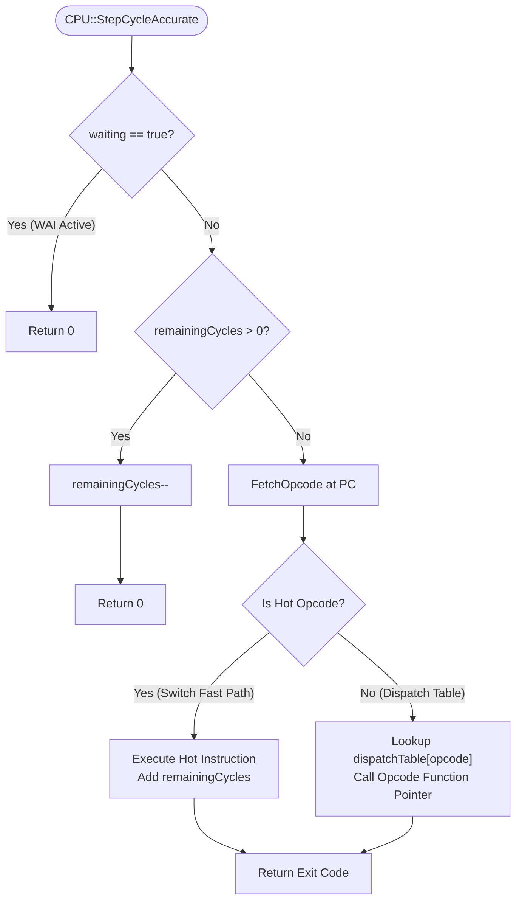

# CPU — WDC 65C02 Processor Emulation

The processor core in **65c02-SIM** models the **Western Design Center (WDC) 65C02** microprocessor, the enhanced CMOS superset of the classic MOS Technology 6502. Written in modern **C++23**, the core prioritizes high instruction throughput, cycle accuracy, and robust debugging support.

**Primary Files:**
- Header: [`src/Hardware/CPU/CPU.h`](file:///home/manu/Documents/GitHub/65c02-SIM/src/Hardware/CPU/CPU.h)
- Registers: [`src/Hardware/CPU/CPURegisters.h`](file:///home/manu/Documents/GitHub/65c02-SIM/src/Hardware/CPU/CPURegisters.h)
- Dispatcher: [`src/Hardware/CPU/Dispatch.h`](file:///home/manu/Documents/GitHub/65c02-SIM/src/Hardware/CPU/Dispatch.h)
- Implementation: [`src/Hardware/CPU/CPU.cpp`](file:///home/manu/Documents/GitHub/65c02-SIM/src/Hardware/CPU/CPU.cpp)

---

## CMOS 65C02 Enhancements & Bug Fixes

Compared to the NMOS 6502, the WDC 65C02 core implements all official silicon improvements and architectural corrections:

1. **Fixed Indirect Jump Bug (`JMP ($xxFF)`)**:
   On NMOS 6502 hardware, executing `JMP ($10FF)` incorrectly fetched the high byte of the target address from `$1000` rather than `$1100` due to a missing internal carry propagation. The 65C02 core properly crosses the page boundary and reads `$1100`.
2. **Defined Decimal (BCD) Mode Behavior**:
   In NMOS silicon, the Negative (`N`) and Zero (`Z`) flags were invalid or undefined after `ADC` or `SBC` in Decimal Mode (`D = 1`). On the 65C02, `N` and `Z` flags reflect the actual valid binary-coded decimal result.
3. **Interrupt Flag Clearing**:
   On the 65C02, hardware interrupts (`IRQ`, `NMI`) automatically clear the Decimal flag (`D = 0`) before entering the interrupt service routine, preventing unexpected decimal arithmetic in interrupt handlers.
4. **Invalid Opcode Safety**:
   NMOS 6502 "undocumented" opcodes often locked the CPU into a crash state (KIL/JAM). The 65C02 maps undefined opcodes to multi-byte/multi-cycle `NOP` variants or explicit `STP` (Stop) instructions.
5. **New Addressing Modes & Instructions**:
   Introduces Zero Page Indirect `($zp)`, Absolute Indexed Indirect `($abs,X)`, single-bit test and manipulation (`RMB`, `SMB`, `BBR`, `BBS`), accumulator increments/decrements (`INC A`, `DEC A`), unconditional relative branching (`BRA`), direct memory zeroing (`STZ`), bit testing (`TRB`, `TSB`), stack register operations (`PHX`, `PLX`, `PHY`, `PLY`), and low-power halt instructions (`WAI`, `STP`).

---

## Register Architecture (`CPURegisters`)

The CPU register state is defined in [`Hardware::CPURegisters`](file:///home/manu/Documents/GitHub/65c02-SIM/src/Hardware/CPU/CPURegisters.h). The struct is designed for optimal cache layout and compiler optimization:

```cpp
struct CPURegisters {
    Word PC{};             // 16-bit Program Counter
    Word SP{};             // 16-bit Stack Pointer (0x0100 - 0x01FF)
    Word instructionPC{0}; // Opcode address of the currently executing instruction

    Byte A{};              // 8-bit Accumulator
    Byte X{};              // 8-bit X Index Register
    Byte Y{};              // 8-bit Y Index Register

    // Status Register Flags (Bitfields)
    Byte C : 1 {0};        // Carry Flag
    Byte Z : 1 {0};        // Zero Flag
    Byte I : 1 {0};        // Interrupt Disable
    Byte D : 1 {0};        // Decimal Mode
    Byte B : 1 {0};        // Break Flag
    Byte V : 1 {0};        // Overflow Flag
    Byte N : 1 {0};        // Negative Flag
};

static_assert(std::is_standard_layout_v<CPURegisters>);
static_assert(std::is_trivially_copyable_v<CPURegisters>);
```

### Processor Status Register (`P` / `NV-BDIZC`)

The 8-bit status byte is reconstructed on demand via `GetStatus()` and unpacked via `SetStatus()`:

| Bit | Symbol | Name | Description |
| :---: | :---: | :--- | :--- |
| **7** | `N` | Negative | Set if bit 7 of the result is `1`. |
| **6** | `V` | Overflow | Set on signed two's-complement arithmetic overflow. |
| **5** | `—` | Unused / Reserved | **Always read as `1`** in `GetStatus()`. Not mapped to a storage bit. |
| **4** | `B` | Break Flag | Distinguishes software `BRK` from hardware `IRQ`/`NMI` when pushed to the stack. |
| **3** | `D` | Decimal Mode | Enables binary-coded decimal (BCD) arithmetic for `ADC` and `SBC`. |
| **2** | `I` | Interrupt Disable | When set to `1`, maskable interrupts (`IRQ`) are ignored. |
| **1** | `Z` | Zero | Set if the result of an operation is exactly `0`. |
| **0** | `C` | Carry | Set on arithmetic unsigned overflow or shift/rotate carry-out. |

```cpp
[[nodiscard]] constexpr Byte GetStatus() const noexcept {
    Byte status = 0;
    status |= C;
    status |= Z << 1;
    status |= I << 2;
    status |= D << 3;
    status |= B << 4;
    status |= 1 << 5;      // Bit 5 is hardwired to 1
    status |= V << 6;
    status |= N << 7;
    return status;
}
```

---

## Execution Loop & C++23 Dispatch Logic

The CPU execution pipeline is designed to eliminate dispatch latency while maintaining full debugging and profiling capabilities.



### Two-Tier Dispatch Mechanism

Opcode dispatch in [`Hardware::CPUDispatch::Dispatch`](file:///home/manu/Documents/GitHub/65c02-SIM/src/Hardware/CPU/Dispatch.h) uses a **two-tier architecture**:

#### Tier 1: The Compile-Time Hot Switch Path
Approximately 90% of typical 6502 machine code consists of common operations (`LDA`, `STA`, `ADC`, `SBC`, `AND`, `ORA`, `CMP`, `INX`, `DEX`, `BEQ`, `BNE`, `JMP`, `JSR`, `RTS`). These opcodes are grouped into the macro `HOT_OPCODE_LIST` and handled in an inline `switch`:

```cpp
switch (opcode) {
#define HOT_CASE(opcodeValue, executor, cycles) \
    case opcodeValue: \
        executor<Debug>(cpu, bus); \
        cpu.remainingCycles += cycles - 1; \
        return 0;
    HOT_OPCODE_LIST(HOT_CASE)
#undef HOT_CASE
    default:
        break;
}
```

Modern compilers (Clang, GCC) lower this switch into an efficient jump table with direct branch predictions, bypassing function pointer indirection entirely.

#### Tier 2: The `constexpr` Fallback Table
Less frequent instructions, bit manipulation, and CMOS extensions are evaluated through a compile-time static array of opcode metadata:

```cpp
template <bool Debug>
struct OpcodeEntry {
    InstructionExecutor<Debug> executor;
    uint8_t baseCycles;
    int8_t exitCode;
};

template <bool Debug>
constexpr std::array<OpcodeEntry<Debug>, 256> dispatchTable = BuildDispatchTable<Debug>();
```

Undefined opcodes produce an `exitCode = -1`, printing an unknown opcode diagnostic and safely halting runaway execution.

### Template Parameterization (`<bool Debug>`)

The entire dispatch pipeline and every instruction function are templated on `<bool Debug>`:
- **`Debug = false` (Turbo / Production Path)**: All profiling branches, CDL map updates, and JSR/BRK tracing calls are evaluated as `if constexpr (Debug)` and completely eliminated by the compiler.
- **`Debug = true` (Instrumented Path)**: Logs memory access to `CDLMap`, checks execution breakpoints, and updates the `SubroutineProfiler`.

---

## Instruction Fetching & Page Pointer Acceleration

Memory reads for instruction fetch operate through [`current_page_ptr`](file:///home/manu/Documents/GitHub/65c02-SIM/src/Hardware/CPU/CPU.h):

```cpp
template <bool Debug>
inline Hardware::Byte Hardware::CPU::FetchOpcode(Bus& bus) {
    instructionPC = PC;
    if constexpr (Debug) {
        bus.LogCDL(PC, CDL_OPCODE);
    }
    Byte dato = 0;
    if (current_page_ptr != nullptr) [[likely]] {
        dato = *current_page_ptr;
        current_page_ptr++;
    } else {
        dato = bus.Read<Debug>(PC);
    }
    PC++;
    if ((PC & 0xFF) == 0) {
        UpdatePagePtr(bus);
    }
    return dato;
}
```

When code executes inside continuous RAM or ROM (the common case), the CPU reads sequential bytes by incrementing `current_page_ptr` directly against host memory. The bus is only queried to re-resolve the page pointer when `PC` crosses a 256-byte page boundary (`(PC & 0xFF) == 0`).

---

## Cycle Accuracy vs. Turbo Mode

The core supports two distinct execution models:

### 1. Cycle-Accurate Mode (`cycleAccurate = true`)

Used during interactive debugging, video raster synchronization, and SID music playback:
- Each instruction initializes `remainingCycles` with the instruction's base cycle cost minus 1.
- `StepCycleAccurate()` decrements `remainingCycles` on each simulator clock tick.
- **Page-Crossing Penalty**: Accessing an effective address across a 256-byte boundary adds an additional penalty cycle:
  ```cpp
  inline void CPU::AddPageCrossPenalty(Word baseAddr, Word effectiveAddr) {
      if (cycleAccurate && ((baseAddr & 0xFF00) != (effectiveAddr & 0xFF00))) {
          remainingCycles++;
          if (profiler != nullptr && profiler->IsEnabled()) [[unlikely]] {
              profiler->OnPageCross(instructionPC, baseAddr, effectiveAddr);
          }
      }
  }
  ```
- **Branch Timing**:
  - Branch not taken: 2 cycles.
  - Branch taken, same page: 3 cycles.
  - Branch taken, across page boundary: 4 cycles.

### 2. Fast Turbo Mode (`cycleAccurate = false`)

Used for automated testing, compiler verification, and headless CLI workflows:
- `StepFast()` executes instructions completely in a single step, returning the total cycles consumed.
- The instruction scheduler advances immediately without waiting through intermediate cycle ticks, reaching speeds exceeding 100 MHz on modern host processors.

### 3. IPS Clock Rate Throttling & Hardware Synchronization

The processor execution frequency is throttled by `Core::EmulationEngine` via `SetTargetIPS(int ips)`:
- **Configurable IPS Range**: Defaults to 1.0 MHz (`1'000'000 IPS`), matching original 6502/65C02 hardware clock rates. It can be throttled down to 1 Hz (for slow-motion instruction inspection) or set to 100+ MHz (or unthrottled Turbo).
- **10ms Time-Slice Pacing**: In `EmulationEngine::ThreadLoop()`, execution is partitioned into 10-millisecond slices (`sliceDurationMs = 10`), calculating an instruction budget per slice:
  $$\text{targetPerSlice} = \frac{\text{currentTargetIPS}}{1000 / \text{sliceDurationMs}} = \frac{\text{currentTargetIPS}}{100}$$
- **Instruction Accumulator**: Fractional remainders are accumulated in `double instructionAccumulator` across slices, preventing long-term clock drift.
- **Peripheral Clock Synchronization (`SyncHardwareCycles`)**:
  On each CPU step, peripherals synchronize their state to the CPU clock:
  ```cpp
  void Emulator::SyncHardwareCycles(bool cpuStepped, bool isNewInstruction, int ips) {
      via.Clock();
      acia.Clock(ips);  // ACIA baud rate dividers scale with active CPU IPS
      if (sidEnabled) {
          sid.Clock();
      }
      serialBridge.DecrementBaudDelay();
  }
  ```
  Because the MOS 6551 ACIA derives its serial baud rates from the system clock, passing `ips` ensures that UART bit timing remains bit-accurate across any target clock rate.

---

## Interrupt Handling & Vectors

The 65C02 features four primary interrupt events:

```
+-------------------------------------------------------------+
| Vector Address | Vector Name | Trigger Source               |
+-------------------------------------------------------------+
| $FFFA - $FFFB  | NMI         | Non-Maskable Interrupt Pin   |
| $FFFC - $FFFD  | RESET       | Cold / Warm System Reset     |
| $FFFE - $FFFF  | IRQ / BRK   | Maskable Pin / BRK Opcode    |
+-------------------------------------------------------------+
```

### 1. System Reset (`Reset()`)

Triggered on power-up or emulator reset:
1. `CPURegisters::Reset()` initializes `PC = 0xFFFC`, `SP = 0x01FF`, and all flags to `0`.
2. `isInit = false`, `waiting = false`, `pendingNMI = false`, `remainingCycles = 0`.
3. On the first step, `EnsureInit()` fetches the 16-bit address stored at `$FFFC`–`$FFFD` into `PC` and initializes `current_page_ptr`.

### 2. Maskable Interrupt (`IRQ`)

Triggered by peripherals (VIA timers, ACIA RX ready):
1. Verified that Interrupt Disable flag `I == 0` (otherwise ignored).
2. `waiting = false` (wakes CPU if in `WAI` state).
3. If cycle-accurate, consumes **7 clock cycles**.
4. Pushes `PC` high byte, then `PC` low byte onto the stack.
5. Pushes `GetStatus()` with Break flag `B = 0`.
6. Sets `I = 1` (prevents nested IRQs) and **clears `D = 0`** (65C02 CMOS specification).
7. Fetches interrupt handler vector from `$FFFE`–`$FFFF` into `PC`.

### 3. Non-Maskable Interrupt (`NMI`)

Triggered by high-priority asynchronous events:
1. Unconditional: ignores the `I` flag.
2. `waiting = false`, `pendingNMI = false`.
3. Consumes **7 clock cycles**.
4. Pushes `PC` (high, then low) and `GetStatus()` with `B = 0` onto the stack.
5. Sets `I = 1` and **clears `D = 0`**.
6. Fetches vector from `$FFFA`–`$FFFB` into `PC`.

### 4. Software Break (`BRK` / `$00`)

Executed directly from program code:
1. Sets internal flag `B = true`.
2. Pushes `PC + 1` onto the stack (accounting for the 1-byte padding signature).
3. Pushes `GetStatus()` with **`B = 1`** onto the stack.
4. Sets `I = 1` and **clears `D = 0`**.
5. If an NMI is concurrently pending, it vectors to `$FFFA`; otherwise it vectors to `$FFFE`.
6. Consumes **7 clock cycles**.

```
Stack State after IRQ / NMI:         Stack State after BRK:
+---------------------------+       +---------------------------+
| SP+3: PC High Byte        |       | SP+3: (PC + 1) High Byte  |
| SP+2: PC Low Byte         |       | SP+2: (PC + 1) Low Byte   |
| SP+1: Status (Bit 4: B=0) |       | SP+1: Status (Bit 4: B=1) |
| SP  : (Next Free Stack)   |       | SP  : (Next Free Stack)   |
+---------------------------+       +---------------------------+
```

### 5. Return from Interrupt (`RTI` / `$40`)

1. Pops the Status byte from the stack and restores all flags via `SetStatus()`.
2. Pops the low and high bytes of `PC`.
3. Updates `current_page_ptr` to the restored location.
4. Consumes **6 clock cycles**.

### 6. Low-Power Modes: `WAI` and `STP`

- **`WAI` (Wait for Interrupt — Opcode `$CB`)**:
  Sets `cpu.waiting = true` and halts execution pipeline. The CPU remains dormant, generating zero host processor load until an external `IRQ` or `NMI` signal is asserted.
- **`STP` (Stop the Processor — Opcode `$DB`)**:
  Halts the CPU completely. Returns `exitCode = 1`, which informs `EmulationEngine` to pause execution and enter the halted state. A hardware reset is required to resume execution.

---

## Stack Architecture

The 65C02 stack is hardwired to **Page 1** (`$0100`–`$01FF`):
- **Stack Pointer (`SP`)**: 16-bit register initialized to `$01FF`. The upper byte is permanently locked to `$01`.
- **Push Operation**: Writes byte to `0x0100 | (SP & 0xFF)`, then decrements `SP`.
- **Pop Operation**: Increments `SP`, then reads byte from `0x0100 | (SP & 0xFF)`.
- **Circular Wraparound**: If more than 256 bytes are pushed without popping, `SP` wraps around within Page 1 (`$0100` to `$01FF`), preventing stack operations from corrupting zero-page or user RAM.
