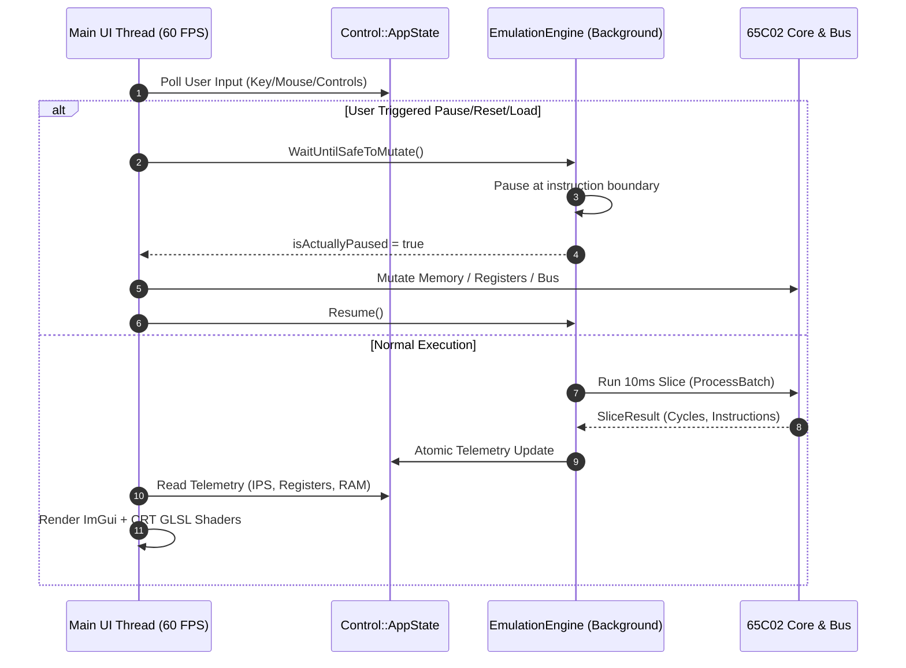

# Frontend — Architecture & Graphical User Interface

**Source Directory:** [`src/Frontend/`](file:///home/manu/Documents/GitHub/65c02-SIM/src/Frontend/)  
**Technologies:** Dear ImGui (Docking branch) · SDL3 · OpenGL 3.3 Core (GLAD) · ImGuiFileDialog

---

## 1. Overview

The **65c02-SIM** frontend delivers a responsive, multi-window graphical interface designed for real-time hardware inspection, code development, and peripheral monitoring. Built upon **Dear ImGui** and accelerated via **OpenGL 3.3**, the frontend is strictly decoupled from the emulation core to guarantee fluid 60 FPS user interaction and tear-free rendering regardless of the CPU emulation workload.

> [!NOTE]
> **Subsystem Logging Behavior:** By default, graphical sessions operate silently without console output (`Core::NullSink`) to avoid terminal pollution and maximize emulation throughput. Console logging can be selectively enabled in GUI mode using `--log-console`, or redirected to disk via `--log-file <path>`. In headless mode (`--headless`), console output (`Core::ConsoleSink`) is enabled by default. See the [Logging Subsystem](Logging-System) documentation for full architectural details.

```
+-----------------------------------------------------------------------------------+
|                                  Main Thread (SDL3)                               |
|                                                                                   |
|  [SDL3 Event Loop] ---> [Dear ImGui Frame] ---> [OpenGL 3.3 Render Pipeline]      |
|                                  |                        |                       |
|                                  v                        v                       |
|                          [Control::AppState]    [GLPostProcessPass (CRT FBOs)]    |
+-----------------------------------------------------------------------------------+
                                   |                             |
                       Atomic Sync / SPSC Queues        PBO Frame Grabber
                                   |                             |
+----------------------------------v-----------------------------v------------------+
|                    Emulation Thread (1-10+ MHz)            Media Exporter Thread  |
|                                                                                   |
|              [Core::EmulationEngine (10ms slices)]         [FFmpegEncoder (H.264)]|
|              [CPU / Bus / VIA / SID / GPU / ACIA]          [SPSC Audio/Video FIFO]|
+-----------------------------------------------------------------------------------+
```

---

## 2. Decoupled Threading Architecture

To support emulation speeds exceeding **10,000,000 instructions per second (10 MHz)** without stuttering the graphical interface or suffering audio crackle, the frontend and emulator core execute on separate threads.

### 2.1 Main Thread vs. Emulation Thread

1. **Main UI Thread (`main.cpp`)**:
   - Manages the SDL3 window, OS event pump, and ImGui input handling.
   - Executes the 60 Hz display refresh synchronized with host V-Sync (`SDL_GL_SetSwapInterval(1)`).
   - Issues OpenGL draw commands for Dear ImGui draw lists and CRT post-processing passes.
   - Throttles rendering during idle emulator states (`SDL_WaitEventTimeout`) to eliminate unnecessary host GPU/CPU load.

2. **Emulation Thread ([`EmulationEngine`](file:///home/manu/Documents/GitHub/65c02-SIM/src/Hardware/Core/Emulator/EmulationEngine.h)):**
   - Runs continuously in a dedicated `std::thread` executing precise 10ms execution slices (`EmulateSlice`).
   - Computes target instruction quanta per slice:  
     $$\text{Instructions per slice} = \frac{\text{Target IPS}}{1000 / 10}$$
   - Synchronizes time against high-resolution monotonic clocks (`std::chrono::high_resolution_clock`), sleeping when execution leads wall-clock time and yielding when lagging.
   - Interacts safely with UI state using lock-free atomic barriers and synchronization primitives.

### 2.2 Concurrency & Safe State Synchronization

State mutation across thread boundaries is handled without heavyweight global mutexes:

- **Lock-Free SPSC Queues ([`Hardware::SPSCQueue<T, N>`](file:///home/manu/Documents/GitHub/65c02-SIM/src/Hardware/Core/SPSCQueue.h))**: Single-producer single-consumer circular ring buffers with `std::atomic<size_t>` head/tail tracking and acquire-release memory orderings. Used for asynchronous video frame streaming (240 frames deep) and audio PCM streaming.
- **Atomic Execution Flags**: Emulation status (`running`, `paused`, `halted`, `targetIPS`) are stored in `std::atomic` variables.
- **Safe State Barrier (`WaitUntilSafeToMutate()`)**: When the UI requires broad structural alterations (such as resetting hardware, flashing a new ROM binary, or resizing memory spaces), the UI invokes `emulator.WaitUntilSafeToMutate()`. The emulation loop pauses cleanly at an instruction boundary, allowing deterministic mutation.



---

## 3. Central State Architecture: `Control::AppState`

All shared configuration, window visibility toggles, telemetry caches, and subsystem pointers are aggregated into [`Control::AppState`](file:///home/manu/Documents/GitHub/65c02-SIM/src/Frontend/Control/AppState.h):

```cpp
struct AppState {
    Emulator emulator;               // Emulation core instance
    ROMState rom;                    // Loaded binary, paths, and debug symbols
    ScriptState script;              // Active script file and console status
    EmulationState emulation;        // Speed, cycle-accuracy, and peripheral toggles
    DebuggerState debugger;          // Active debugger mode (0-9) and heatmap toggles
    UpdateState update;              // GitHub HTTPS update status
    CRTSettings crt;                 // Real-time CRT filter shader parameters
    RenderState render;              // GL textures, UI scale factor, FBOs
    PopupState popups;               // Modal dialogues and cartridge SD save alerts
    SDKState sdk;                    // Built-in SDK demo ROMs and assets
    IDEState ide;                    // Integrated IDE buffers and toolchain state
    NetworkSnifferState sniffer;     // ESP8266 traffic sniffer state and packet logs
    ScannerState scanner;            // Memory cheat engine search criteria & candidate list
    bool requestExit = false;        // Application termination request
    GUI::CRTFilter crtFilter;        // Post-processing OpenGL pipeline
};
```

### Key Sub-States

| Sub-State Struct | Source Header | Responsibilities |
| :--- | :--- | :--- |
| [`ROMState`](file:///home/manu/Documents/GitHub/65c02-SIM/src/Frontend/Control/EmulationState.h) | `EmulationState.h` | Holds binary ROM path, loaded status, symbol table (`SymbolTable`), and raw file payload. |
| [`EmulationState`](file:///home/manu/Documents/GitHub/65c02-SIM/src/Frontend/Control/EmulationState.h) | `EmulationState.h` | Target IPS (default 1,000,000), peripheral enable flags (`gpuEnabled`, `espEnabled`, `sdEnabled`), cycle accuracy mode, auto-reload file watcher, and media recording configuration. |
| [`IDEState`](file:///home/manu/Documents/GitHub/65c02-SIM/src/Frontend/Control/IDEState.h) | `IDEState.h` | Open status, source code buffer, compiler diagnostic output, current file path, and active mode (`IDEMode::C`, `ASM`, `MicroDOS`, `MIDI`). |
| [`DebuggerState`](file:///home/manu/Documents/GitHub/65c02-SIM/src/Frontend/Control/UIModalState.h) | `UIModalState.h` | Debugger window open toggle and active view mode ([`DebuggerMode`](file:///home/manu/Documents/GitHub/65c02-SIM/src/Frontend/Control/UIModalState.h) enum with 10 modules). |
| [`CRTSettings`](file:///home/manu/Documents/GitHub/65c02-SIM/src/Frontend/Control/AppState.h) | `AppState.h` | Boolean toggles for 20 shader effects, monitor phosphor type (`RGB`, `GreenP1`, `AmberP3`, `WhiteP4`), gamma curve, and time uniforms. |

---

## 4. UI Modules Breakdown

Window rendering is organized into modular drawing routines dispatched from [`Frontend::DrawGUIWindows()`](file:///home/manu/Documents/GitHub/65c02-SIM/src/Frontend/GUI/UIModules.cpp):

```
Frontend/GUI/
├── ControlWindow.cpp        ← Master emulation controls, speed sliders & Registers Section
├── ConsoleWindow.cpp        ← Interactive VT100 terminal & ACIA bridge
├── RegistersWindow.cpp      ← CPU register inspector & status flag bitfield (embedded in Control)
├── LCDWindow.cpp            ← HD44780 2x16 character display
├── SIDViewerWindow.cpp      ← 3-voice SID synthesizer oscilloscope & ADSR
├── ScriptConsoleWindow.cpp  ← Custom scripting language console output
├── IDEWindow.cpp            ← Integrated C/ASM source code IDE
├── MIDI/
│   └── MIDIWorkspaceWindow  ← Multi-track piano roll & tracker (active in IDEMode::MIDI)
├── Video/
│   ├── VRAMViewerWindow.cpp ← 100x75 GPU frame buffer viewer & palette inspector
│   ├── CRTFilter.cpp        ← Multi-pass GLSL post-processing controller
│   └── GLPostProcessPass.cpp← FBO ping-pong texture manager
└── Debugger/                ← Integrated Hardware Debugger Suite (10 modules)
```

### 4.1 ControlWindow — Master Emulation Controls
Provides primary execution controls:
- **Run / Pause**: Toggles background execution slice scheduling.
- **Step**: Executes exactly one 65C02 instruction step, completing internal cycle ticks.
- **Reset**: Fires a hardware reset vector (`$FFFC-$FFFD`) and restores memory mapped registers.
- **Speed Limit (IPS)**: Real-time slider adjusting target speed from 10 Hz up to uncapped 50+ MHz.
- **Performance Readout**: Displays actual real-world IPS achieved, CPU load %, and slice late penalties.
- **Peripheral Toggles**: Immediate hot-plug toggles for GPU, SID, ESP8266 WiFi, and SD Card.
- **Registers Dashboard ([`RegistersWindow.cpp`](file:///home/manu/Documents/GitHub/65c02-SIM/src/Frontend/GUI/RegistersWindow.cpp))**: Embedded section displaying 16-bit `PC` and `SP`, 8-bit `A`, `X`, `Y`, colored flags (`NV-BDIZC`), and remaining cycle countdown.

### 4.2 LCDWindow — 2×16 Monospace Display
Simulates a physical 2-line by 16-character liquid crystal display attached via VIA Port B. Renders ASCII characters and custom character generator RAM (CGRAM) glyphs using retro green/blue backlighting styles.

### 4.3 VRAMViewerWindow — Graphics Surface
Displays the raw 100×75 VRAM surface generated by the GPU (`$2000-$3FFF`).
- **Memory Stride**: Renders using a 128-byte stride format matching physical hardware.
- **Pixel Inspector**: Hover over any coordinate to view the exact memory address, offset, and RGB color components.
- **Palette Controls**: Switch between direct color and indexed palettes.

### 4.4 SIDViewerWindow & MIDIWorkspaceWindow
- **SIDViewerWindow ([`SIDViewerWindow.cpp`](file:///home/manu/Documents/GitHub/65c02-SIM/src/Frontend/GUI/SIDViewerWindow.cpp))**: Displays real-time hardware status of the MOS 6581 / 8580 SID sound generator (voice frequencies, pulse width duty cycles, ADSR envelopes, filter cutoff/resonance).
- **MIDIWorkspaceWindow ([`MIDIWorkspaceWindow.cpp`](file:///home/manu/Documents/GitHub/65c02-SIM/src/Frontend/GUI/MIDI/MIDIWorkspaceWindow.h))**: Specialized workspace rendered when `state.ide.mode == Control::IDEMode::MIDI`, enabling piano roll editing and interactive audio synthesis alongside the SID viewer.

---

## 5. Terminal Console & ANSI VT100 Parser

The text console ([`ConsoleWindow.cpp`](file:///home/manu/Documents/GitHub/65c02-SIM/src/Frontend/GUI/ConsoleWindow.cpp)) serves as the interactive serial terminal connected to the W65C51N ACIA device (`$5000-$5003`).

### 5.1 Architecture

```
[65C02 Program via ACIA Tx]
            │
            ▼
 [AnsiVt100Parser::ProcessChar] ◄── Cursor query responses injected via InjectKey()
            │
            ▼
   [TerminalBuffer]
    ├── Primary Screen (2D vector<vector<Cell>>)
    ├── Alternate Screen (altScreen)
    ├── Scrollback History
    └── SGR Text Attributes (Color, Bold, Underline)
            │
            ▼
[ConsoleView ImGui Renderer]
```

### 5.2 TerminalBuffer Details
[`Console::TerminalBuffer`](file:///home/manu/Documents/GitHub/65c02-SIM/src/Hardware/Core/TerminalBuffer.h) maintains:
- **Dual Screen Buffers**: Standard primary buffer and alternate screen buffer (`altScreen`) for full-screen CLI apps (e.g. `vi`, text editors, or `microDOS` shells).
- **Cursor Tracking**: Coordinates (`cursorX`, `cursorY`), saved positions, and cursor blink timers.
- **SGR Formatting**: 256-color and 24-bit TrueColor ANSI styling, bold, dim, italic, and underline text.

### 5.3 VT100 Parser State Machine
[`Console::AnsiVt100Parser`](file:///home/manu/Documents/GitHub/65c02-SIM/src/Hardware/Core/AnsiVt100Parser.h) implements a standard DEC VT100/VT220 state machine:
- **States**: `Ground`, `Escape`, `Csi` (Control Sequence Introducer), `CharsetG0`, `CharsetG1`, `Osc` (Operating System Command).
- **DEC Special Character Sets**: Translates VT100 line-drawing characters (box characters, corners, crosses) into UTF-8 codepoints.
- **Bidirectional Control**: Responds to cursor position queries (`ESC [ 6 n`) by injecting coordinates back into the CPU keyboard queue (`InjectKey`).

---

## 6. OpenGL Post-Processing & CRT Shaders

To faithfully recreate the visual experience of vintage composite and RGB CRT monitors, the frontend implements a modular GPU post-processing pipeline.

### 6.1 Ping-Pong FBO Architecture
[`GUI::GLPostProcessPass`](file:///home/manu/Documents/GitHub/65c02-SIM/src/Frontend/GUI/Video/GLPostProcessPass.h) manages two double-buffered Framebuffer Objects (`m_fbo[2]`, `m_outputTex[2]`):
1. **Pass 1**: The raw VRAM texture (100×75) is upscaled into FBO 0 at 8× subpixel scaling (800×600).
2. **Pass 2**: CRT shader kernels process the intermediate texture into FBO 1, sampling previous frames to compute analog persistence.
3. **Pass 3**: Final composited image is rendered to the ImGui viewport quad.

### 6.2 GLSL Shaders (`crt.vert` and `crt.frag`)
The CRT filter suite applies comprehensive optical and analog simulations configured via uniforms:

```glsl
// Uniform configuration in crt.frag
uniform sampler2D u_texture;     // Current frame FBO
uniform sampler2D u_prevFrame;   // Previous frame for decay/persistence
uniform vec2      u_nativeSize;  // Native VRAM dimensions (100x75)
uniform vec2      u_outputSize;  // Target scaled viewport resolution
uniform float     u_time;        // Animation time base
uniform int       u_monitorType; // 0=RGB, 1=Green P1, 2=Amber P3, 3=White P4
```

#### Supported CRT Filter Categories

| Category | Filter Uniform | Physical / Analog Simulation |
| :--- | :--- | :--- |
| **Essentials** | `u_scanlines` | Simulates horizontal cathode ray blanking lines across scanlines. |
| | `u_interlacing` | Alternates odd/even scanlines on alternating frames. |
| | `u_curvature` | Barrel distortion simulating the curved glass surface of a CRT tube. |
| | `u_chromatic` | Misaligned red, green, and blue electron guns causing color fringing. |
| | `u_blur` | Horizontal phosphor bleeding across adjacent beam sweeps. |
| **Physicality** | `u_shadowMask` | Fine aperture grille or shadow dot mask phosphor pattern. |
| | `u_vignette` | Natural edge falloff and corner darkening from tube geometry. |
| | `u_cornerRounding`| Soft rounded bezel corners masking the tube edges. |
| | `u_glassGlare` | Specular ambient light reflection on the outer tube face. |
| **Analog Imperfections** | `u_colorBleeding` | NTSC/PAL luma/chroma crosstalk and composite video signal smear. |
| | `u_noise` | High-frequency RF static noise and analog signal grain. |
| | `u_vsyncJitter` | Subtle vertical sync timing drift and field jitter. |
| | `u_phosphorDecay` | Phosphor persistence and decay trail ("ghosting"). |
| | `u_humBar` | 50/60 Hz AC power ground loop horizontal hum bar rolling vertically. |
| **Lighting** | `u_bloom` | Glow bleeding outward from high-intensity beam strikes. |
| | `u_halation` | Internal reflection within the CRT front glass. |
| | `u_moire` | Interference pattern between screen pixel grid and phosphor mask. |
| | `u_gamma` | Accurate non-linear CRT gamma curve transfer (default 2.75). |
| | `u_sharpPixels` | Preserves sharp pixel edges on 100x75 display before post-processing. |
| | `u_ghosting` | Secondary shadow deflection reflections. |

#### Phosphor Monitor Types
The `uMonitorType` uniform shifts the spectral output to replicate historic monitors:
- **RGB**: Full-color shadow mask / Trinitron display.
- **Green P1**: Monochromatic green display (525 nm peak wavelength, e.g., Apple Monitor III).
- **Amber P3**: Amber phosphor display (590 nm peak wavelength, high contrast).
- **White P4**: Monochrome black-and-white phosphor (early terminals, portable CRT sets).

---

## 7. Media Recording Pipeline

The frontend includes a high-throughput, multi-track multimedia exporter ([`MediaExporter.h`](file:///home/manu/Documents/GitHub/65c02-SIM/src/Frontend/MediaExporter.h) & [`FFmpegEncoder.h`](file:///home/manu/Documents/GitHub/65c02-SIM/src/Frontend/FFmpegEncoder.h)) powered by **FFmpeg** (`libavcodec`, `libavformat`, `libswscale`, `libavutil`).

### 7.1 Pipeline Architecture

```
[OpenGL Render Target]                      [SID Audio Generator]
         │                                            │
         ▼                                            ▼
[GLPboFrameGrabber (Asynchronous PBO)]       [Audio Stream Callback]
         │                                            │
         ▼                                            ▼
  Video SPSCQueue <240 frames>                 Audio SPSCQueue <240 blocks>
         │                                            │
         └───────────────────────┬────────────────────┘
                                 │
                                 ▼
                    [MediaExporter Worker Thread]
                                 │
                                 ▼
                     [FFmpegEncoder Processing]
                      ├── Video Track 0: Processed CRT (H.264)
                      ├── Video Track 1: Raw Digital VRAM (H.264)
                      └── Audio Track: Stereo SID Audio (FLAC/WAV/OPUS)
                                 │
                                 ▼
                      [Multiplexed Container]
                         (.mkv / .mp4 file)
```

### 7.2 Technical Implementation
- **Zero-Stall Asynchronous PBO Grabber ([`GLPboFrameGrabber`](file:///home/manu/Documents/GitHub/65c02-SIM/src/Frontend/GLPboFrameGrabber.h))**: Double-buffered OpenGL Pixel Buffer Objects (`glReadPixels` via DMA) prevent the CPU from blocking while reading back GPU framebuffers.
- **Simultaneous Dual-Video Tracks**: The recorder captures both the high-resolution processed CRT view and the raw native 100×75 VRAM pixels simultaneously into independent video tracks inside a single MKV container.
- **Audio FIFO Buffer (`AVAudioFifo`)**: Synchronizes varying sample packet sizes from the SID synthesis callback to fixed audio codec frame sizes.
- **Standalone Audio Recorder ([`Hardware::AudioRecorder`](file:///home/manu/Documents/GitHub/65c02-SIM/src/Hardware/Audio/AudioRecorder.h))**: When recording audio only (`RecordingType::Audio`), the emulator routes PCM samples directly through a lightweight background worker thread writing standard 16-bit PCM WAV streams, avoiding FFmpeg library overhead.
- **Encoders Supported**:
  - Video: H.264 / AVC (`libx264`).
  - Audio: FLAC (Lossless 24-bit), WAV (PCM 16-bit), OPUS (Streaming 48 kHz).

---

## 8. Headless Execution Mode

For continuous integration (CI/CD) test runners, automated regression testing, and headless benchmarks, **65c02-SIM** can be launched entirely without graphical dependencies via [`Frontend::HeadlessRunner`](file:///home/manu/Documents/GitHub/65c02-SIM/src/Frontend/HeadlessRunner.h).

### 8.1 Command-Line Syntax

```bash
./SIM_65C02 --headless [OPTIONS] [ROM_FILE]
```

### 8.2 CLI Arguments Table

| Option | Argument | Description |
| :--- | :--- | :--- |
| `--headless` | None | Runs without SDL3 window creation or OpenGL context initialization. |
| `--rom` | `<path>` | Path to binary ROM image or `.65c` cartridge archive. Fallback: `output/rom/room.bin`. |
| `--script` | `<path>` | Executes an embedded custom script file and mirrors output to `stdout`. |
| `--run-cycles` | `<N>` | Advances the 65C02 CPU exactly $N$ cycles after reset and then terminates. |
| `--dump-mem` | `<file>` | Dumps the full 64 KB bus memory space to a raw binary file upon termination. |
| `--sid` / `--no-sid` | None | Enables or disables the MOS SID sound hardware. |
| `--sid-sound` | None | Enables real-time host audio output in headless mode. |
| `--profile-sid`| None | Outputs fine-grained execution nanosecond benchmarks for all SID stages. |
| `--nsf-trace` | `<path>` | Generates an NSF audio execution JSON trace report. |
| `--nsf-duration`| `<sec>` | Maximum execution duration for NSF traces. |
| `--nsf-song` | `<index>`| Song track index for NSF playback. |
| `--log-console` | None | Enables console logging in GUI mode (default is silent / `NullSink`). |
| `--log-file` | `<path>` | Appends formatted log entries to the specified file (`FileSink`). |
| `--log-level` | `<level>` | Sets minimum log severity: `trace`, `debug`, `info`, `warn`, `error`, `critical`, or `off`. |

### 8.3 Example: Headless Automated Regression

```bash
# Execute ROM for 2,000,000 cycles with a test script, then dump RAM
./SIM_65C02 --headless \
            --rom build/firmware.bin \
            --script tests/verify_state.sim \
            --run-cycles 2000000 \
            --dump-mem /tmp/mem_dump.bin

# Verify test assertion exit code
echo "Headless test run completed successfully."
```

### 8.4 Logging & Diagnostics Configuration

By default, the graphical frontend suppresses terminal log spew using `Core::NullSink`. In contrast, headless mode activates `Core::ConsoleSink` to stream diagnostic telemetry to standard output.

Both execution profiles can be configured via command-line flags:
- **Enable Console Output in GUI Mode**: Use `--log-console` to stream logs directly to the launching terminal.
- **Log to File**: Pass `--log-file <path>` to capture logs on disk via `Core::FileSink`.
- **Set Severity Threshold**: Pass `--log-level <level>` (e.g. `--log-level debug` or `--log-level warn`) to filter messages.

For in-depth details on sink architecture, custom sinks, and C++23 usage, consult the [Logging Subsystem](Logging-System) guide.
