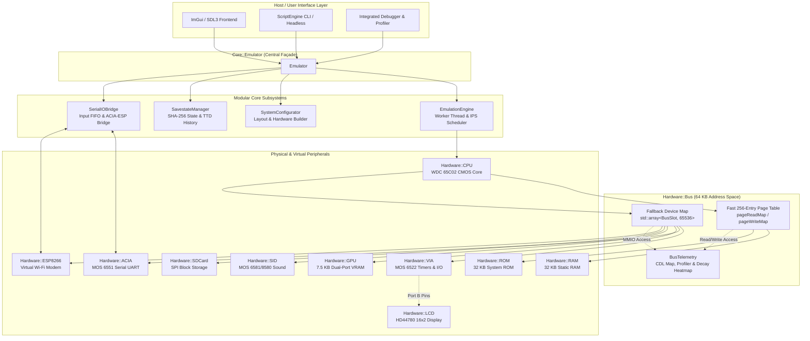

# Hardware — Modular Core Architecture & Bus Subsystem

The hardware subsystem in **65c02-SIM** models a complete 8-bit personal computer architecture built around the Western Design Center (WDC) 65C02 microprocessor. Built in **modern C++23**, the architecture is decomposed into decoupled, highly cohesive modular engines managed by an overarching orchestrator façade.

---

## Architecture Overview



---

## The `Core::Emulator` Façade

The [`Core::Emulator`](file:///home/manu/Documents/GitHub/65c02-SIM/src/Hardware/Core/Emulator/Emulator.h) class serves as the **unifying façade** for the entire emulation system. Rather than implementing execution scheduling, configuration parsing, or serialization directly, it aggregates specialized components and coordinates interactions between the user interface, scripting engine, and virtual hardware.

### Lifecycle Management

```cpp
Core::Emulator emulator;
std::string errorMsg;

// Load a 32 KB ROM binary or cartridge
if (emulator.Init("firmware.bin", errorMsg)) {
    emulator.Start();    // Spawns dedicated worker thread
}

// Runtime Execution Controls
emulator.Pause();        // Pauses execution deterministically
emulator.Resume();       // Resumes thread execution
emulator.Reset();        // Performs hardware cold reset
emulator.Stop();         // Joins emulation thread and terminates
```

### Component Delegation Matrix

| Concern | Delegated Subsystem | Description |
| :--- | :--- | :--- |
| **Worker Thread & Throttling** | `Core::EmulationEngine` | Controls the dedicated execution thread, slice timing, and IPS clock rate. |
| **Hardware Configuration** | `Core::SystemConfigurator` | Configures memory maps, mounts disk images, and binds devices. |
| **Save States & Rewind** | `Core::SavestateManager` | Manages SHA-256 state hashing and circular XOR delta history. |
| **Serial Input/Output** | `Core::SerialIOBridge` | Thread-safe input FIFO, baud rate throttling, and ACIA/ESP bridging. |
| **Subroutine Profiling** | `Hardware::SubroutineProfiler`| Call-graph, cycle timing, and page-cross penalty tracing. |
| **Logic Analysis** | `Hardware::LogicAnalyzer` | Cycle-by-cycle signal transition logging. |

---

## Multithreaded `EmulationEngine`

Execution runs decoupled from the GUI rendering loop on an independent `std::thread`. This guarantees that simulator clock timing remains rock-solid regardless of frontend frame rates (V-Sync, window resizing, or UI load).

### Time-Slice Scheduler & IPS Throttling

The engine achieves accurate instruction-per-second (IPS) pacing through a **10-millisecond time-slice scheduler** (`ThreadLoop` in [`EmulationEngine.cpp`](file:///home/manu/Documents/GitHub/65c02-SIM/src/Hardware/Core/Emulator/EmulationEngine.cpp)):

```cpp
int sliceDurationMs = 10;
double targetPerSlice = (double)currentTargetIPS / (1000.0 / sliceDurationMs);

instructionAccumulator += targetPerSlice;
int instructionsPerSlice = (int)instructionAccumulator;
instructionAccumulator -= instructionsPerSlice;

const auto sliceStart = std::chrono::high_resolution_clock::now();
const SliceResult slice = EmulateSlice(instructionsPerSlice);
const auto sliceEnd = std::chrono::high_resolution_clock::now();
```

- **Target IPS**: Controlled with `SetTargetIPS(int ips)`. Standard frequency is 1 MHz (`1'000'000`), but it can be set anywhere from 1 Hz up to 100+ MHz (or uncapped turbo mode).
- **Instruction Accumulator**: Fractional instruction counts are accumulated across slices, preventing cumulative drift.
- **Dynamic Sleep vs. Yield**: If the slice finishes ahead of wall-clock deadline (`sleepCheckTime < nextSliceTime`), the worker sleeps via `std::this_thread::sleep_until()`. If execution lags behind, it yields to prevent thread starvation and logs latency via `SchedulerTelemetry`.

### Batch Execution Pipeline

Calling `Step()` in a tight loop across millions of instructions incurs excessive function call overhead. Inside `EmulateSlice()`, instructions are dispatched in batches of up to **500,000 instructions** (`ProcessBatch`):

```cpp
int EmulationEngine::ProcessBatch(int count, bool hooks, bool hasBreakpoints, 
                                  bool hasComplex, int& batchInstructions,
                                  uint64_t& batchCpuCycles, uint64_t& batchGpuCycles, 
                                  int& stopCode);
```

- When active hooks (debugger breakpoints, watchpoints, CDL logging) are absent, the batch loop uses an unhooked fast path, maximizing host CPU cache locality and branch predictor efficiency.
- If a breakpoint, watchpoint, or processor stop instruction (`STP`) triggers, `ProcessBatch` halts early and returns the exact stopping code.

### Safe Mutation Barrier

To allow the GUI thread to read or mutate emulator state (e.g., injecting a cartridge, modifying memory in the hex editor, capturing a savestate) without race conditions:

```cpp
void EmulationEngine::WaitUntilSafeToMutate() {
    if (!running || std::this_thread::get_id() == emulatorThread.get_id()) {
        paused = true;
        isActuallyPaused = true;
        return;
    }
    if (!paused) {
        Pause();
    }
    while (!isActuallyPaused.load(std::memory_order_acquire)) {
        if (!running) return;
        std::this_thread::yield();
    }
}
```

The calling thread signals pause and spins lightly until `isActuallyPaused` is asserted by the worker thread loop, guaranteeing an immutable memory snapshot.

---

## Hardware Configuration (`SystemConfigurator`)

The [`SystemConfigurator`](file:///home/manu/Documents/GitHub/65c02-SIM/src/Hardware/Core/Emulator/SystemConfigurator.h) dynamically constructs the memory layout and sets up peripheral attachments.

### Dynamic Cartridge vs. Default Layout

When loading a program:
1. **Cartridge Layout (`.65c`)**: If a cartridge defines custom bus devices in its metadata, `RegisterCartridgeLayout()` iterates over the defined memory segments and registers them into the bus.
2. **Default Layout**: If no cartridge is loaded, `RegisterDefaultLayout()` initializes the classic Ben Eater extended memory map:
   - RAM: `$0000`–`$7FFF` (32 KB)
   - ROM: `$8000`–`$FFFF` (32 KB)
   - ACIA: `$5000`–`$5003`
   - VIA: `$6000`–`$600F`
   - ESP8266: `$5004`–`$5007`
   - SD Card: `$5008`–`$500B`
   - SID: `$4800`–`$481F`
   - GPU: `$2000`–`$3FFF` (overlapping RAM when GPU is enabled)

### Automatic Asset Attachment

- **VRAM Initialization**: Cartridges with embedded graphics (`.vramData`) have their contents automatically copied to GPU memory via `LoadCartridgeVRAMIfPresent()`.
- **Disk Image Mounting**: Cartridges with an embedded `.sd` image or standalone binaries with an adjacent `.sd` file are mounted automatically into `Hardware::SDCard`.
- **VIA Port B Callback**: Attaches a lambda callback to VIA Port B to forward LCD control commands (`HandleVIAPortB`).

---

## Serial I/O Bridge (`SerialIOBridge`)

The [`SerialIOBridge`](file:///home/manu/Documents/GitHub/65c02-SIM/src/Hardware/Core/Emulator/SerialIOBridge.h) handles communication between host input devices and serial peripherals:

```cpp
class SerialIOBridge {
    std::deque<char> inputBuffer;
    mutable std::mutex bufferMutex;
    std::atomic<bool> hasInput{false};
    int baudDelay = 0;
    bool aciaEspBridge = false;
};
```

1. **Thread-Safe Input Injection**: GUI keypresses (`InjectKey`, `InjectText`) are pushed to a thread-safe FIFO.
2. **Baud Rate Throttling**: The 65C02 CPU reads characters from ACIA at simulated bus speeds. Pushing characters too fast causes buffer overruns in target firmware. `SerialIOBridge` enforces a configurable `baudDelay` between characters matching standard 19200 or 115200 baud timings.
3. **ACIA <-> ESP8266 Bridge**: When enabled (`SetACIAESPBridge(true)`), serial characters emitted by ACIA are routed directly into the virtual ESP8266 modem, enabling network communication over standard serial terminal firmware.

---

## Memory Bus Architecture (`Hardware::Bus`)

The [`Hardware::Bus`](file:///home/manu/Documents/GitHub/65c02-SIM/src/Hardware/Core/Bus.h) class orchestrates the entire 16-bit address space (65,536 bytes) with high performance and zero unnecessary abstractions.

```
+-------------------------------------------------------------------+
|                     64 KB Address Space                           |
+-------------------------------------------------------------------+
| 0x0000 - 0x7FFF | RAM (32 KB)                                     |
|   0x2000-0x3FFF |   [Overlaid by GPU VRAM when GPU enabled]       |
| 0x4800 - 0x481F | SID Sound Synthesizer                           |
| 0x5000 - 0x5003 | ACIA Serial UART                                |
| 0x5004 - 0x5007 | ESP8266 Virtual Modem                           |
| 0x5008 - 0x500B | SD Card SPI Storage                             |
| 0x6000 - 0x600F | VIA Parallel I/O & Timers                       |
| 0x8000 - 0xFFFF | ROM (32 KB, Read-Only)                          |
|   0xFFFA-0xFFFB |   NMI Vector                                    |
|   0xFFFC-0xFFFD |   RESET Vector                                  |
|   0xFFFE-0xFFFF |   IRQ / BRK Vector                              |
+-------------------------------------------------------------------+
```

### The Fast 256-Entry Page Table

Traditional emulators query a map or vector on every byte read/write. In 65c02-SIM, the bus implements a **direct-mapped 256-entry Page Table** (`pageReadMap` and `pageWriteMap`):

- The 64 KB memory space is divided into 256 pages of 256 bytes each (`addr >> 8`).
- During `RebuildDeviceMap()`, the bus examines each page. If all 256 bytes of a page belong to a single device that provides contiguous raw memory via `IBusDevice::GetRawMemory()` (such as RAM or ROM), the bus caches the direct host pointer:

```cpp
// Bus.cpp: UpdateCache()
if (pageIsUniform) {
    Byte* rawPtr = firstDevice->GetRawMemory();
    Byte* memoryBase = rawPtr + baseOffset;

    pageReadMap[page] = memoryBase;
    if (!firstDevice->IsReadOnly()) {
        pageWriteMap[page] = memoryBase;
    }
}
```

#### Fast-Path Single-Cycle Reads & Writes

When the CPU reads or writes memory without active debug hooks:

```cpp
template <bool Debug>
inline Byte Bus::Read(Word address) {
    if constexpr (Debug) {
        telemetry.LogRead(address);
    }

    // FAST PATH: Direct raw pointer lookup
    if (Byte* memoryBase = pageReadMap[address >> 8]) [[likely]] {
        return memoryBase[address & 0xFFU];
    }

    // FALLBACK PATH: MMIO peripheral dispatch
    const auto& slot = deviceMap[address];
    if (slot.device != nullptr) {
        return slot.device->Read(slot.offset);
    }
    return 0;
}
```

- **99%+ of memory operations** (RAM variables, zero page, stack, ROM instructions) resolve with a single pointer addition and dereference (`memoryBase[address & 0xFF]`).
- **Read-Only Protection**: For ROM pages, `pageWriteMap[page]` is set to `nullptr`. Any write attempt to ROM bypasses the fast path and is silently ignored or intercepted by the fallback table without corrupting memory.

### Device Registration & Conflict Resolution

Peripherals implement the [`IBusDevice`](file:///home/manu/Documents/GitHub/65c02-SIM/src/Hardware/Core/IBusDevice.h) interface:

```cpp
class IBusDevice : public ISerializable {
public:
    virtual std::string GetName() const = 0;
    virtual Byte Read(Word offset) = 0;
    virtual void Write(Word offset, Byte data) = 0;
    virtual Byte ReadDirect(Word offset) const { return 0; }
    virtual void WriteDirect(Word offset, Byte data) {}
    virtual Byte* GetRawMemory() { return nullptr; }
    virtual size_t GetRawMemorySize() const { return 0; }
    virtual bool IsReadOnly() const { return false; }
};
```

Devices are registered into the bus with address boundaries:

```cpp
bus.RegisterDevice(0x6000, 0x600F, &via, true, true);
```

1. **Collision Checking**: Unless `ignoreCollision` is true, registering overlapping memory regions causes `RebuildDeviceMap()` to throw `std::runtime_error`, preventing accidental address decoding conflicts in custom cartridges.
2. **Prioritized Overlay**: Devices registered with `ignoreCollision = true` (e.g., MMIO registers that puncture RAM ranges) overwrite earlier registrations in the secondary `deviceMap`.

### Virtual Devices

Peripherals that do not possess dedicated address lines on the physical memory bus—such as the **LCD** (which is controlled via VIA Port B pins) or internal controllers—are registered via:

```cpp
bus.RegisterVirtualDevice(&lcd, true);
```

Virtual devices:
- Do not participate in address decoding or collision detection (`startAddress = 0, endAddress = 0, isVirtual = true`).
- Appear in the GUI debugger's Memory Layout window.
- Participate in state serialization and queryable enabled status.

### Global Write Hooks

The bus supports attaching arbitrary write listener callbacks:

```cpp
bus.AddGlobalWriteHook([](Word address, Byte data) {
    // Invoked on memory writes when debug hooks are active
});
```

This mechanism powers memory watchpoints in `BreakpointManager` and cycle-accurate tracing in `LogicAnalyzer`.

---

## Telemetry, CDL & Profiling Subsystems

The [`BusTelemetry`](file:///home/manu/Documents/GitHub/65c02-SIM/src/Hardware/Core/BusTelemetry.h) structure aggregates profiling and instrumentation metrics with zero overhead when disabled:

### Code-Data-Log (CDL) Engine

The CDL engine maintains a 64 KB bitfield array (`cdlMap`) categorizing how each byte of memory has been accessed by the CPU:

```cpp
enum CDLFlags : uint8_t {
    CDL_NONE       = 0,
    CDL_OPCODE     = 1 << 0,  // Byte was fetched as instruction opcode
    CDL_DATA       = 1 << 1,  // Byte was accessed as data operand
    CDL_ZP_POINTER = 1 << 2,  // Byte was read as Zero Page indirect pointer
    CDL_OPERAND    = 1 << 3,  // Byte was fetched as instruction parameter
};
```

- When the CPU executes `FetchOpcode<true>()`, it calls `bus.LogCDL(PC, CDL_OPCODE)`.
- When fetching parameters or reading zero-page pointers, the corresponding bits are set.
- The debugger uses the CDL map to generate perfect disassemblies, distinguishing executable code from embedded lookup tables.

### Memory Access Profiler

Flat 64K 32-bit integer arrays record access counts across the address space:
- `profilerReadCounts`: Number of reads per address.
- `profilerWriteCounts`: Number of writes per address.
- `profilerCounts`: Combined access frequency.

Data is accessible via `bus.GetProfilerCounts()` and displayed in the Memory Profiler window as real-time bar graphs and hot-spot tables.

### Real-Time Heatmaps with Exponential Decay

To visualize instantaneous memory activity, the bus maintains atomic heat tables (`readHeat`, `writeHeat`):
- Accessing an address sets its atomic heat value to `255`:
  ```cpp
  readHeat.at(address).store(255, std::memory_order_relaxed);
  ```
- Periodically, the GUI thread calls `bus.DecayHeatmap(amount)` (typically `amount = 2` or `4`), decaying active cells toward `0`.
- Cells are rendered in the Hex Editor with color-coded luminescence (e.g., bright green for reads, bright red for writes), visually exposing stack activity, zero-page variables, and loop buffers.

---

## Default MMIO Register Reference

| Address | Register | Peripheral | Function |
| :--- | :--- | :--- | :--- |
| `0x4800`–`0x481F` | `SID_REGS` | SID 6581 | Voice 1–3 frequencies, pulse widths, control, ADSR, filter modes, volume |
| `0x5000` | `ACIA_DATA` | ACIA 6551 | Transmit / Receive serial data byte |
| `0x5001` | `ACIA_STATUS` | ACIA 6551 | Parity, overrun, framing, TX ready, RX full, IRQ status |
| `0x5002` | `ACIA_CMD` | ACIA 6551 | Command register: DTR, interrupt control, parity mode |
| `0x5003` | `ACIA_CTRL` | ACIA 6551 | Control register: Baud rate select, word length, stop bits |
| `0x5004`–`0x5007` | `ESP_REGS` | ESP8266 | Command, data, status, and network configuration registers |
| `0x5008` | `SD_CTRL` | SD Card | SPI chip select, transfer trigger, status |
| `0x5009` | `SD_DATA` | SD Card | SPI byte transfer data register |
| `0x6000` | `PORTB` | VIA 6522 | Bidirectional 8-bit Port B (drives LCD data/control pins) |
| `0x6001` | `PORTA` | VIA 6522 | Bidirectional 8-bit Port A |
| `0x6002` | `DDRB` | VIA 6522 | Data Direction Register B |
| `0x6003` | `DDRA` | VIA 6522 | Data Direction Register A |
| `0x6004`–`0x6005` | `T1C_L / T1C_H`| VIA 6522 | Timer 1 Counter Low / High bytes |
| `0x6006`–`0x6007` | `T1L_L / T1L_H`| VIA 6522 | Timer 1 Latch Low / High bytes |
| `0x6008`–`0x6009` | `T2C_L / T2C_H`| VIA 6522 | Timer 2 Counter Low / High bytes |
| `0x600A` | `VIA_SR` | VIA 6522 | Serial Shift Register |
| `0x600B` | `ACR` | VIA 6522 | Auxiliary Control Register (Timer & Shift Register modes) |
| `0x600C` | `PCR` | VIA 6522 | Peripheral Control Register (Handshake and interrupt control) |
| `0x600D` | `IFR` | VIA 6522 | Interrupt Flag Register |
| `0x600E` | `IER` | VIA 6522 | Interrupt Enable Register |
| `0x600F` | `ORA_NH` | VIA 6522 | Output Register A with No Handshake |
