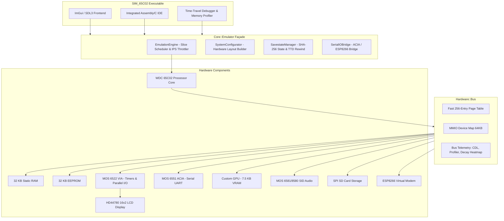

# 65c02-SIM — Modern WDC 65C02 Hardware Simulator & Ecosystem

Welcome to the official technical documentation for **65c02-SIM**, a cycle-accurate simulator of the Western Design Center **WDC 65C02** CMOS microprocessor and a complete modular 8-bit personal computer platform written in modern **C++23**.

Originally conceived as an emulation of [Ben Eater's 8-bit breadboard computer](https://eater.net/6502), 65c02-SIM has evolved into a full-fledged virtual hardware workstation featuring rich peripheral integration, custom graphics and sound synthesis, Time-Travel Debugging (TTD), native LLVM-MOS toolchain support, and an immediate-mode graphical debugger.

---

## Technical Origin: From Ben Eater's Breadboard to a CMOS Workstation

Ben Eater's popular educational computer series established an elegant, minimalist 6502 architecture consisting of:
- A MOS 6502 CPU operating with a manual or low-frequency clock.
- A 64 KB memory space split evenly: **32 KB RAM** (`$0000`–`$7FFF`) and **32 KB ROM** (`$8000`–`$FFFF`).
- A **MOS 6522 Versatile Interface Adapter (VIA)** mapped at `$6000`–`$600F` controlling an HD44780-compatible 16×2 character LCD.
- A **MOS 6551 ACIA** serial communications interface mapped at `$5000`–`$5003` for UART console I/O.

65c02-SIM takes this foundation as its default hardware profile and dramatically expands it into a high-performance modern virtual system:
1. **CMOS Upgrade (WDC 65C02)**: Replaces the NMOS 6502 with the enhanced WDC 65C02 core, adding bit manipulation instructions (`RMB`, `SMB`, `BBR`, `BBS`), stack extensions (`PHX`, `PLX`, `PHY`, `PLY`), unconditional relative branches (`BRA`), zeroing memory (`STZ`), bit testing (`TRB`, `TSB`), and low-power modes (`WAI`, `STP`). All NMOS hardware bugs (such as the indirect `JMP ($xxFF)` page-boundary bug) are fully fixed.
2. **Dedicated MMIO Graphics Processor (GPU)**: Introduces a dedicated 7.5 KB VRAM graphical subsystem capable of bitmap graphics (320×240 mono or 160×120 16-color) and CRT raster-beam simulation with slow-motion analysis.
3. **Polyphonic Audio Synthesis (SID)**: Emulates the Commodore 64's MOS 6581/8580 Sound Interface Device with 3 independent voices, multimode resonant filter, and ADSR envelopes.
4. **Block Storage via SPI**: Provides an SPI-driven SD Card controller mapped to MMIO registers, supporting standard FAT32 `.sd` disk images.
5. **Networking via Virtual AT Modem**: Emulates an Espressif ESP8266 Wi-Fi module responding to standard Hayes `AT` commands, bridging emulator software to host TCP/IP sockets.
6. **Cartridge Container System (`.65c`)**: Packages code, custom hardware memory mappings, initial VRAM assets, and persistent SD card images into a unified, self-configuring container.



---

## Git Worktree Architecture

The 65c02-SIM project is organized across seven specialized **Git Worktrees** (branches checked out into independent directories). This modular architecture cleanly isolates the core simulator engine from development tools, target software, runtime libraries, and assets:

| Worktree Path | Branch | Purpose & Contents |
| :--- | :--- | :--- |
| `/` (Root) | `master` | **Core Emulator & Frontend**: C++23 source code (`src/`), CMake build configuration, unit test suite (`src/UnitTests/`), ImGui/SDL3/OpenGL3 frontend, and core documentation. |
| `/assets` | `Assets` | **Binary Assets**: Font atlases, default firmware ROMs, graphical splash screens, sample sound patches, and icon resources. |
| `/sdk` | `SDK` | **Software Development Kit**: LLVM-MOS cross-compilation toolchain integration, system headers (`include/`), C runtimes (`crt0.s`), BIOS assembly routines, and compilation shell scripts (`compile-bin.sh`, `create-cartridge.sh`, `midi-to-bin.sh`, `image-to-bin.sh`). |
| `/sdk/msbasic` | `MSBasic` | **Microsoft BASIC (1977)**: Full 6502 port adapted to the 65c02-SIM memory map and BIOS hooks, providing an interactive BASIC environment out of the box. |
| `/sdk/microdos` | `MicroDOS` | **MicroDOS Operating System**: Lightweight disk operating system featuring a command shell, FAT16/FAT32 file drivers, text-mode utilities, and direct integration with `MicroDosGPU`. |
| `/tools` | `Tools` | **Tooling & Code Generators**: Python-based linker script generators (`generate_cfg.py`, `generate_link_ld.py`, `generate_app_link_ld.py`), MIDI-to-SID converters, image-to-VRAM converters, and asset processing scripts. |
| `/wiki` | `Wiki` | **Technical Documentation**: The standalone documentation repository powering the GitHub project wiki. |

Managing dependencies via dedicated worktrees enables developing software in C or assembly in `/sdk` or modifying system ROMs without polluting the git log of the core C++ emulator.

---

## System Specifications Matrix

| Specification | Details |
| :--- | :--- |
| **CPU Architecture** | Western Design Center (WDC) 65C02 CMOS, 8-bit data bus, 16-bit address bus. |
| **Instruction Set** | Full 65C02 set (212 valid opcodes), including all CMOS extensions and 16 addressing modes. |
| **Clock Throttling** | High-precision time-slice scheduler capable of 1 Hz to 100+ MHz (unthrottled Turbo mode). Default: 1.000 MHz. |
| **Cycle Accuracy** | Configurable: Cycle-Accurate Mode with page-boundary penalties vs. Turbo Fast Mode. |
| **Standard RAM** | 32 KB high-speed SRAM (`$0000`–`$7FFF`). Supports power-on randomizing patterns. Overlaid by GPU VRAM (`$2000`–`$3FFF`) when GPU is enabled. |
| **Standard ROM** | 32 KB EEPROM (`$8000`–`$FFFF`). Contains system BIOS, reset vector (`$FFFC`–`$FFFD`), and interrupt vectors (`$FFFA`–`$FFFF`). |
| **Video Subsystem** | Custom GPU with 7.5 KB dual-port VRAM (`$2000`–`$3FFF`), 320×240 monochrome or 160×120 16-color chunky framebuffer; optional MicroDOS text mode GPU. |
| **Audio Subsystem** | MOS 6581/8580 SID emulation (`$4800`–`$481F`): 3 oscillators, 4 waveforms, programmable 12 dB/oct multimode filter, ADSR envelopes, WAV audio recording. |
| **Serial I/O** | MOS 6551 ACIA (`$5000`–`$5003`) with configurable baud rate delay throttling and thread-safe keyboard buffer injection. |
| **Parallel I/O & Timers**| MOS 6522 VIA (`$6000`–`$600F`): Two 16-bit interval timers, 8-bit shift register, two 8-bit bidirectional I/O ports. |
| **Display** | HD44780 16×2 character LCD display connected virtually to VIA Port B. |
| **Mass Storage** | SPI-mode SD Card controller mapped to MMIO registers (`$5008`–`$500B`). Supports hot-swappable raw FAT disk images. |
| **Networking** | Espressif ESP8266 Wi-Fi module simulation (`$5004`–`$5007` or bridged through ACIA) with AT command parser and host socket bridging. |
| **Save State Format** | Custom versioned binary container (`SIM65C02SST`) with dual SHA-256 checksums and Time-Travel Debugging (TTD) circular buffer. |

---

## Feature Matrix

| Feature | Description |
| :--- | :--- |
| **Two-Tier CPU Dispatch** | Hot-path branchless opcode dispatch with fallback `constexpr` dispatch table, providing near-native host execution speeds. |
| **Fast Page Table Bus** | 256-entry direct pointer lookup table (`pageReadMap` / `pageWriteMap`) eliminating MMIO dispatch overhead for uniform 256-byte RAM/ROM pages. |
| **Time-Travel Debugging** | Step backwards in time using a 600-snapshot circular buffer with automatic XOR delta compression (90%+ memory savings). |
| **Code-Data-Log (CDL)** | Real-time classification of every byte in the 64 KB address space (`Opcode`, `Data`, `Pointer`, `Operand`) for reverse-engineering and disassembly. |
| **Memory Heatmap** | Dual read/write access intensity tracking with configurable decay rates, rendered in real time in the debugger. |
| **Subroutine Profiler** | Call-graph profiler tracking execution frequencies, inclusive/exclusive cycle counts, and page-crossing penalties across `JSR`, `RTS`, `BRK`, and interrupts. |
| **Logic Analyzer** | Cycle-by-cycle signal recorder capturing address bus, data bus, R/W line, and IRQ/NMI transitions. |
| **LLVM-MOS Toolchain** | Full modern C/C++ compilation pipeline targeting the 65C02 with aggressive optimizations (`-O3`, dead code elimination, whole-program LTO). |
| **Cross-Platform** | Native Linux, macOS, and Windows builds using SDL3 and OpenGL 3.3, plus a WebAssembly (WASM) build runnable directly in modern browsers. |

---

## Quickstart Guide

### 1. Launching the Emulator

Pre-compiled binaries are provided on the GitHub Releases page. Alternatively, build the project following [Building](Building):

```bash
# Launch GUI on Desktop
./build/bin/SIM_65C02

# Launch in Headless Mode (CLI / Automated testing)
./build/bin/SIM_65C02 --headless --rom my_rom.bin --run-cycles 1000000
```

### 2. Compiling Software with the SDK

The SDK uses the modern **LLVM-MOS** compiler suite. Make sure `mos-common-clang` or `mos-clang` is available in your PATH or in `build/llvm_mos/`.

```bash
# Compile a C or Assembly program from sdk/src/
./sdk/scripts/compile-bin.sh hello_world

# Compile with optimization level 3
./sdk/scripts/compile-bin.sh -O3 graphics_demo

# Package into a self-contained .65c Cartridge with custom hardware configuration
./sdk/scripts/create-cartridge.sh -n "MyGame" -r output/rom/mygame.bin -o mygame.65c
```

### 3. Converting Assets

```bash
# Convert an image into VRAM chunky bitmap format
./sdk/scripts/image-to-bin.sh assets/textures/logo.png output/vram/logo.bin

# Convert a Standard MIDI file (.mid) to SID driver assembly code
./sdk/scripts/midi-to-bin.sh music/song.mid output/audio/song.s
```

---

## Documentation Index

Explore the remaining wiki sections for comprehensive technical documentation:

### Hardware & Core Subsystems
- **[Hardware](Hardware)** — Modular emulator core façade, multithreaded engine, fast page-table bus, and telemetry.
- **[CPU](CPU)** — WDC 65C02 execution model, registers, C++23 dispatch logic, cycle accuracy, and interrupt handling.
- **[CPU Instructions](CPU-Instructions)** — Complete reference of all 212 opcodes, CMOS extensions, addressing modes, and cycle timings.
- **[Save States & TTD](Save-States)** — Binary serialization protocol, SHA-256 verification, and XOR delta Time-Travel Debugging.
- **[GPU & Video](GPU)** — Framebuffer architecture, VRAM layout, raster-beam slow motion, and MicroDOS GPU.
- **[SID Audio](SID)** — 6581/8580 voice synthesis, filter mathematics, and audio playback.
- **[VIA and ACIA](VIA-and-ACIA)** — MOS 6522 timer/IO operation and MOS 6551 serial communications.
- **[SD Card Storage](SD-Card)** — MMIO SPI controller and disk image mounting.
- **[ESP8266 Modem](ESP8266-and-NET-Library)** — Virtual Wi-Fi networking and high-level C NET library.
- **[Cartridge System](Cartridge-System)** — `.65c` format specification and dynamic hardware layout mapping.

### User Interface & Debugging
- **[Frontend](Frontend)** — ImGui UI layout, memory hex editor, register inspector, and display controls.
- **[Debugger](Debugger)** — Integrated source-level debugger, disassembly, and profiler.
- **[Breakpoints](Breakpoints)** — Execution, read/write memory watchpoints, and conditional expressions.
- **[Scripting Engine](Scripting)** — Custom embedded scripting language for headless automated testing and automation.

### SDK & Software Development
- **[SDK Overview](SDK)** — LLVM-MOS setup, project structure, build targets, and toolchain scripts.
- **[Linker & Memory Layout](Linker-and-Memory-Layout)** — Linker configuration (`.ld`), C runtime, BIOS routines, and memory mapping.
- **[SDK Programs](SDK-Programs)** — Walkthrough of included C and assembly sample applications.
- **[Building from Source](Building)** — CMake compilation guide for Linux, Windows, macOS, and WebAssembly.
- **[Unit Tests](Unit-Tests)** — GoogleTest test harness and validation coverage.

---

## License

65c02-SIM is open-source software licensed under the **MIT License**.  
The project includes educational adaptations of Microsoft BASIC (© 1977 Microsoft) and WozMon (© 1976 Apple Computer, Inc.).
