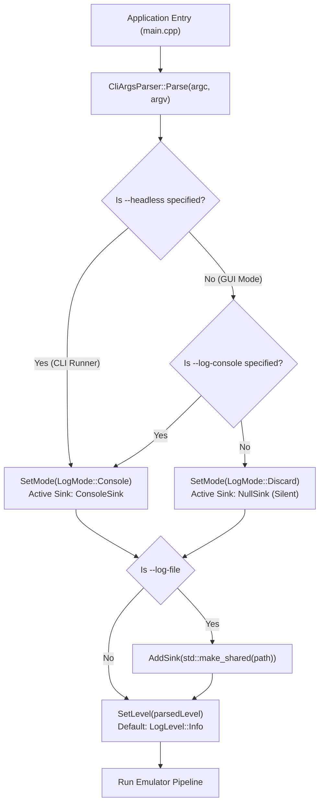

# Logging Subsystem — Architecture & Multi-Sink Diagnostics

**Source Directory:** [`src/Hardware/Core/`](file:///home/manu/Documents/GitHub/65c02-SIM/src/Hardware/Core/)  
**Primary Header:** [`src/Hardware/Core/Logger.h`](file:///home/manu/Documents/GitHub/65c02-SIM/src/Hardware/Core/Logger.h)  
**Implementation:** [`src/Hardware/Core/Logger.cpp`](file:///home/manu/Documents/GitHub/65c02-SIM/src/Hardware/Core/Logger.cpp)  
**Technologies:** C++23 (`std::format`, `std::format_string`, `std::string_view`, concepts) · Multi-sink pipeline · Mutex-synchronized thread safety

---

## 1. Overview

The **65c02-SIM** logging subsystem provides a centralized, thread-safe, and low-overhead diagnostics pipeline designed specifically for mixed graphical and headless emulation environments. Written in modern **C++23**, the system decouples subsystem log producers (CPU core, memory bus, VIA/ACIA peripherals, SID audio, and GPU video) from concrete log consumers via an extensible sink architecture ([`Core::ILogSink`](file:///home/manu/Documents/GitHub/65c02-SIM/src/Hardware/Core/Logger.h#L32-L37)).

```
                                      +---------------------------------------------+
                                      |                Core::Logger                 |
 [CPU / Bus Subsystems] ------------> |  - Mutex Synchronized (m_mutex)             |
 [Audio / SID Engine]   ------------> |  - Level Threshold Check (ShouldLog)        |
 [Frontend / UI Thread] ------------> |  - C++23 Compile-Time Format Validation     |
                                      +---------------------------------------------+
                                                             |
                                                             | Dispatches to active sinks
                                                             v
                             +-------------------------------+-------------------------------+
                             |                               |                               |
                             v                               v                               v
                     +---------------+               +---------------+               +---------------+
                     |   NullSink    |               |  ConsoleSink  |               |   FileSink    |
                     | (GUI Default) |               | (stdout/err)  |               | (Disk Output) |
                     +---------------+               +---------------+               +---------------+
                             |                               |                               |
                             v                               v                               v
                       [Discarded]                   [Host Terminal]                  [logfile.log]
```

### Key Design Goals

1. **Zero Terminal Pollution in GUI Mode**: When launched as a desktop graphical application, emulator and hardware telemetry outputs are discarded by default through [`Core::NullSink`](file:///home/manu/Documents/GitHub/65c02-SIM/src/Hardware/Core/Logger.h#L39-L42), keeping the launching shell clean.
2. **Transparent CLI & Headless Diagnostics**: Headless regression runs, CI/CD runners, and batch tests automatically channel diagnostic outputs to the console through [`Core::ConsoleSink`](file:///home/manu/Documents/GitHub/65c02-SIM/src/Hardware/Core/Logger.h#L44-L48).
3. **Compile-Time Format Verification**: Leveraging C++23 `std::format_string<Args...>`, all format strings and arguments are validated at compile time, eliminating format mismatch crashes while retaining zero runtime allocation on filtered log calls.
4. **Multi-Thread Concurrency**: Safe concurrent logging from the 60 Hz SDL3 UI thread, the background emulation thread (1–10+ MHz slices), and real-time audio generation callbacks.
5. **Runtime Sink Extensibility**: Pluggable sink interface allowing the frontend or developer tooling to attach custom sinks (such as in-engine Dear ImGui log viewer windows or circular memory telemetry buffers).

---

## 2. Core Architecture & Interfaces

The subsystem is encapsulated within the `Core` namespace.

### 2.1 Log Levels (`Core::LogLevel`)

Log severity is defined by [`Core::LogLevel`](file:///home/manu/Documents/GitHub/65c02-SIM/src/Hardware/Core/Logger.h#L16-L24):

| Level | Value | Purpose | Default Output Channel |
| :--- | :---: | :--- | :--- |
| `LogLevel::Trace` | `0` | Ultra-verbose cycle-by-cycle or bus transaction tracing | `std::cout` |
| `LogLevel::Debug` | `1` | Subsystem internal state transitions and register changes | `std::cout` |
| `LogLevel::Info` | `2` | Informational events (ROM loading, cartridge mounts, reset vectors) | `std::cout` |
| `LogLevel::Warn` | `3` | Non-fatal emulation anomalies (unmapped I/O reads, timing drops) | `std::cerr` |
| `LogLevel::Error` | `4` | Recoverable errors (failed script execution, missing assets) | `std::cerr` |
| `LogLevel::Critical` | `5` | Unrecoverable failures (invalid host state, allocation aborts) | `std::cerr` |
| `LogLevel::Off` | `6` | Special sentinel to suppress all logging completely | *None* |

### 2.2 Sink Interface (`Core::ILogSink`)

Every log target implements the pure virtual interface [`Core::ILogSink`](file:///home/manu/Documents/GitHub/65c02-SIM/src/Hardware/Core/Logger.h#L32-L37):

```cpp
namespace Core {

class ILogSink {
public:
    virtual ~ILogSink() = default;
    virtual void Write(LogLevel level, std::string_view message) = 0;
    virtual void Flush() {}
};

} // namespace Core
```

- `Write(level, message)`: Invoked whenever an active log message passes the minimum severity threshold. The message is passed as a zero-copy `std::string_view`.
- `Flush()`: Flushes any intermediate stream buffers. Optional for in-memory sinks; implemented for stream-based sinks (`ConsoleSink`, `FileSink`).

### 2.3 Built-in Sinks

The subsystem provides three built-in sink implementations:

1. **[`NullSink`](file:///home/manu/Documents/GitHub/65c02-SIM/src/Hardware/Core/Logger.h#L39-L42)**:
   - Discards all incoming messages as a no-op:
     ```cpp
     void Write(LogLevel, std::string_view) override {}
     ```
   - Used as the default sink in GUI mode to guarantee zero overhead and zero terminal noise.

2. **[`ConsoleSink`](file:///home/manu/Documents/GitHub/65c02-SIM/src/Hardware/Core/Logger.h#L44-L48)**:
   - Directs logs to standard output streams:
     * Levels `Trace`, `Debug`, and `Info` $\rightarrow$ `std::cout`
     * Levels `Warn`, `Error`, and `Critical` $\rightarrow$ `std::cerr`
   - Flushes both streams upon `Flush()`.

3. **[`FileSink`](file:///home/manu/Documents/GitHub/65c02-SIM/src/Hardware/Core/Logger.h#L50-L58)**:
   - Appends formatted messages with severity prefixes (`[TRACE] `, `[DEBUG] `, `[INFO] `, `[WARN] `, `[ERROR] `, `[CRIT] `) to an on-disk log file.
   - Opens the target file in append mode (`std::ios::out | std::ios::app`).

### 2.4 Log Modes (`Core::LogMode`)

High-level operational presets are managed via [`Core::LogMode`](file:///home/manu/Documents/GitHub/65c02-SIM/src/Hardware/Core/Logger.h#L26-L30):

```cpp
enum class LogMode : uint8_t {
    Discard,  // Populates only NullSink
    Console,  // Populates only ConsoleSink
    Custom    // Managed manually via AddSink / ClearSinks
};
```

---

## 3. Execution Modes & Default Behaviors

To maintain an optimal user experience across development, debugging, and production use, **65c02-SIM** dynamically sets the logging mode according to the application launch profile:



### 3.1 GUI Mode (Default: Silent)
When launching the emulator directly into the graphical interface (`./SIM_65C02 [ROM_PATH]`):
- The logger initializes in `LogMode::Discard` with a single [`NullSink`](file:///home/manu/Documents/GitHub/65c02-SIM/src/Hardware/Core/Logger.h#L39-L42).
- Terminal output is completely suppressed. Emulation runs at peak performance without blocking on host console I/O.
- If diagnostic output is desired during GUI sessions, users can supply `--log-console` or `--log-file <path>`.

### 3.2 CLI / Headless Mode (`--headless`)
When launching for automated batch runs, test suites, or script automation:
- The runner automatically switches the logger to `LogMode::Console` with [`ConsoleSink`](file:///home/manu/Documents/GitHub/65c02-SIM/src/Hardware/Core/Logger.h#L44-L48).
- Progress diagnostics, ROM load notifications, and execution errors stream directly to `stdout`/`stderr`.

---

## 4. Command-Line Options Reference

The logging subsystem is configured at startup through the standard CLI arguments parser:

| CLI Option | Parameter | Default | Description |
| :--- | :--- | :--- | :--- |
| `--headless` | *None* | `false` | Launches without GUI window creation and sets the default logging mode to `LogMode::Console`. |
| `--log-console` | *None* | `false` | Explicitly enables console output (`ConsoleSink`) in GUI mode. |
| `--log-file` | `<path>` | *None* | Appends all log entries to the specified disk path using [`Core::FileSink`](file:///home/manu/Documents/GitHub/65c02-SIM/src/Hardware/Core/Logger.h#L50-L58). Can be used simultaneously with console logging. |
| `--log-level` | `<level>` | `info` | Sets the minimum threshold for captured logs. Options: `trace`, `debug`, `info`, `warn`, `error`, `critical`, `off`. |

### CLI Invocation Examples

```bash
# 1. Standard GUI run (silent terminal output)
./SIM_65C02 output/rom/room.bin

# 2. GUI run with debug console logging enabled
./SIM_65C02 --log-console --log-level debug output/rom/room.bin

# 3. GUI run outputting trace diagnostics directly to a file
./SIM_65C02 --log-file /tmp/emulator.log --log-level trace output/rom/room.bin

# 4. Headless automated regression run with warning/error filter only
./SIM_65C02 --headless --log-level warn --run-cycles 5000000 --dump-mem /tmp/ram.bin

# 5. Dual logging: output to console and persist full debug logs to disk
./SIM_65C02 --headless --log-file /tmp/ci_debug.log --log-level debug
```

---

## 5. Thread Safety & Concurrency

The **65c02-SIM** architecture utilizes multiple asynchronous threads:
- **Main UI Thread**: ImGui rendering, event pumping, and window management.
- **Emulation Engine Thread**: High-frequency CPU instruction dispatch (10ms batch slices).
- **Audio Thread**: High-priority real-time SID synthesis callbacks.
- **Media Exporter Thread**: Asynchronous FFmpeg encoding and PBO frame grabbing.

```
       [UI Thread]             [Emulation Thread]            [Audio Thread]
            │                          │                           │
            │ Logger::Info(...)        │ Logger::Warn(...)         │ Logger::Error(...)
            │                          │                           │
            └──────────────────────────┼───────────────────────────┘
                                       │
                                       v
                     +───────────────────────────────────+
                     |        Core::Logger::Log          |
                     |                                   |
                     | 1. if (!ShouldLog(level)) return  |
                     | 2. std::lock_guard<std::mutex>    |
                     | 3. for (auto& sink : m_sinks)     |
                     |        sink->Write(level, msg)    |
                     +───────────────────────────────────+
```

### Mutex Protection & Lock Contention Minimization

1. **Early Filter Check (`ShouldLog`)**:
   Before acquiring the internal mutex or executing expensive string formatting, [`Core::Logger::ShouldLog()`](file:///home/manu/Documents/GitHub/65c02-SIM/src/Hardware/Core/Logger.h#L74) performs an inline check against the current `m_level`:
   ```cpp
   [[nodiscard]] bool ShouldLog(LogLevel level) const noexcept {
       return level >= m_level && m_level != LogLevel::Off;
   }
   ```
   If a log call's severity is below the active threshold (e.g., `Trace` when the level is `Info`), formatting and synchronization are completely bypassed.

2. **Sink Dispatch Mutex (`m_mutex`)**:
   When a message qualifies for dispatch, an internal `std::mutex` guards the sink vector:
   - Prevents race conditions during dynamic sink reconfiguration (`AddSink`, `ClearSinks`, `SetMode`).
   - Serializes concurrent writes across the emulation loop, audio callbacks, and UI threads to guarantee coherent lines without interleaved characters.

---

## 6. C++23 Modern API & Code Examples

The logging subsystem provides static helper methods on [`Core::Logger`](file:///home/manu/Documents/GitHub/65c02-SIM/src/Hardware/Core/Logger.h#L60) wrapping compile-time format validation.

### 6.1 Basic Logging Calls

```cpp
#include "Hardware/Core/Logger.h"

// Simple string view logging
Core::Logger::Info("Emulation engine initialized successfully.");
Core::Logger::Warn("VIA timer B underflow without IRQ acknowledgment.");
Core::Logger::Error("Failed to open ROM image file.");

// Formatted logging with C++23 std::format syntax
Core::Logger::Info("Loaded ROM: {} (Size: {} bytes)", romPath, romSize);
Core::Logger::Debug("Reset vector fetched: PC={:#06x}, SP={:#04x}", resetPC, stackPointer);
Core::Logger::Warn("Illegal opcode {:#02x} encountered at address {:#06x}", opcode, currentPC);
Core::Logger::Trace("Cycle count: {}, Active instruction: {}", totalCycles, mnemonic);
```

### 6.2 Compile-Time Format Validation

Because [`Core::Logger`](file:///home/manu/Documents/GitHub/65c02-SIM/src/Hardware/Core/Logger.h#L79) uses `std::format_string<Args...>`, incorrect format tokens or mismatched argument types produce clear compile-time errors rather than runtime undefined behavior:

```cpp
// Correct usage:
Core::Logger::Info("Memory write at {:#06x}: {:#04x}", 0x8000, 0xEA);

// Compile error (detected at compile time due to std::format_string):
// Core::Logger::Info("Value: {:d}", "not an integer");
```

---

## 7. Extending with Custom Sinks

The multi-sink architecture makes it straightforward to capture logs for custom tooling, developer overlays, or network telemetry.

### 7.1 Example: In-Engine Dear ImGui Console Sink

Below is an implementation of a custom sink capturing messages into a circular buffer for display inside an ImGui developer window:

```cpp
#include "Hardware/Core/Logger.h"
#include <deque>
#include <mutex>
#include <string>

class ImGuiLogViewerSink final : public Core::ILogSink {
public:
    struct LogItem {
        Core::LogLevel level;
        std::string text;
    };

    explicit ImGuiLogViewerSink(size_t maxHistory = 1000)
        : m_maxHistory(maxHistory) {}

    void Write(Core::LogLevel level, std::string_view message) override {
        std::lock_guard<std::mutex> lock(m_bufferMutex);
        if (m_items.size() >= m_maxHistory) {
            m_items.pop_front();
        }
        m_items.push_back({level, std::string(message)});
    }

    void RenderImGuiWindow() {
        std::lock_guard<std::mutex> lock(m_bufferMutex);
        for (const auto& item : m_items) {
            // Apply color coding based on severity
            if (item.level >= Core::LogLevel::Error) {
                ImGui::TextColored(ImVec4(1.0f, 0.4f, 0.4f, 1.0f), "%s", item.text.c_str());
            } else if (item.level == Core::LogLevel::Warn) {
                ImGui::TextColored(ImVec4(1.0f, 0.8f, 0.2f, 1.0f), "%s", item.text.c_str());
            } else {
                ImGui::TextUnformatted(item.text.c_str());
            }
        }
    }

private:
    std::mutex m_bufferMutex;
    std::deque<LogItem> m_items;
    size_t m_maxHistory;
};
```

### 7.2 Registering the Custom Sink

Register the custom sink with the global logger singleton during application initialization:

```cpp
auto guiSink = std::make_shared<ImGuiLogViewerSink>(2000);
Core::Logger::Instance().AddSink(guiSink);
```

Once registered, calls across all threads to `Core::Logger::*` will safely dispatch into `ImGuiLogViewerSink::Write()` alongside any existing file or console sinks.

---

## 8. Subsystem Integration Summary

| Subsystem | Typical Severity | Typical Diagnostic Content |
| :--- | :--- | :--- |
| **CPU (`src/Hardware/CPU/`)** | `Trace`, `Debug`, `Warn` | Instruction disassembly, cycle telemetry, STP/WAI state, illegal opcodes |
| **Bus / Memory (`src/Hardware/Core/Bus.cpp`)** | `Warn`, `Error` | Unmapped access warnings, ROM write attempts, cartridge bank switches |
| **Cartridge (`src/Hardware/Core/Cartridge.cpp`)** | `Info`, `Error` | Header parsing, CRC32 verification, SD save image syncing |
| **SID Audio (`src/Hardware/Audio/`)** | `Debug`, `Warn` | Audio buffer overruns/underruns, filter parameter updates |
| **ACIA / ESP8266 (`src/Hardware/Peripherals/`)** | `Trace`, `Info` | Serial communication packets, baud rate changes, AT commands |
| **Frontend Runner (`src/Frontend/`)** | `Info`, `Error` | SDL window lifecycle, GL shader compilation, script execution status |
