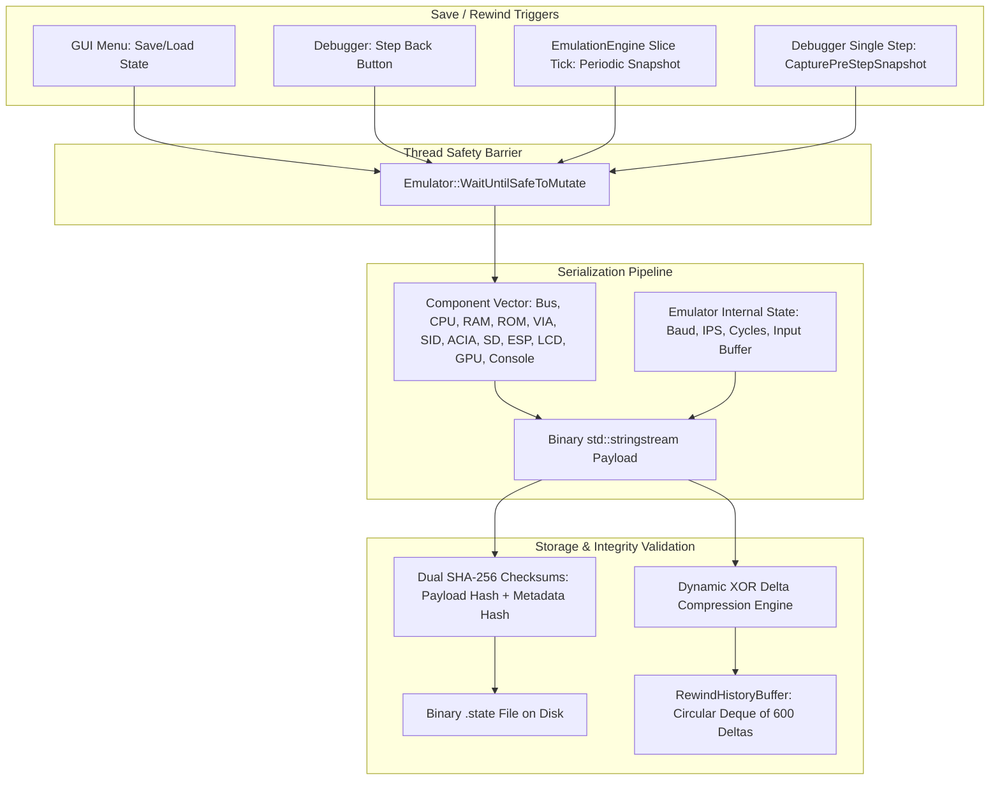
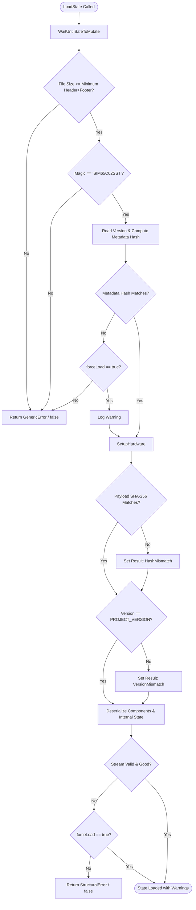

# Save States & Time-Travel Debugging (TTD)

The save-state and time-travel debugging system in **65c02-SIM** provides deterministic, instantaneous state preservation and bidirectional execution history. Built using **modern C++23**, the system combines a strict component serialization protocol, SHA-256 cryptographic integrity verification, and a high-performance circular snapshot buffer with dynamic XOR delta compression.

**Primary Files:**
- Manager: [`src/Hardware/Core/Emulator/SavestateManager.h`](file:///home/manu/Documents/GitHub/65c02-SIM/src/Hardware/Core/Emulator/SavestateManager.h) / [`.cpp`](file:///home/manu/Documents/GitHub/65c02-SIM/src/Hardware/Core/Emulator/SavestateManager.cpp)
- Rewind Buffer: [`src/Hardware/Core/Emulator/RewindHistoryBuffer.h`](file:///home/manu/Documents/GitHub/65c02-SIM/src/Hardware/Core/Emulator/RewindHistoryBuffer.h) / [`.cpp`](file:///home/manu/Documents/GitHub/65c02-SIM/src/Hardware/Core/Emulator/RewindHistoryBuffer.cpp)
- Interface: [`src/Hardware/Core/ISerializable.h`](file:///home/manu/Documents/GitHub/65c02-SIM/src/Hardware/Core/ISerializable.h)
- Serializer: [`src/Hardware/Core/BinarySerializer.h`](file:///home/manu/Documents/GitHub/65c02-SIM/src/Hardware/Core/BinarySerializer.h)
- Cryptography: [`src/Hardware/Core/SHA256.h`](file:///home/manu/Documents/GitHub/65c02-SIM/src/Hardware/Core/SHA256.h)

---

## Architecture Overview



---

## The `ISerializable` Interface & C++23 Binary Serializer

Every physical peripheral, memory unit, and internal controller implements the [`ISerializable`](file:///home/manu/Documents/GitHub/65c02-SIM/src/Hardware/Core/ISerializable.h) interface:

```cpp
class ISerializable {
public:
    virtual ~ISerializable() = default;
    virtual bool SaveState(std::ostream& out) const = 0;
    virtual bool LoadState(std::istream& inStream) = 0;
};
```

Low-level primitives and trivially copyable structs are serialized via [`Hardware::BinarySerializer`](file:///home/manu/Documents/GitHub/65c02-SIM/src/Hardware/Core/BinarySerializer.h) using modern C++23 type traits and `std::bit_cast`:

```cpp
template <typename T>
inline void Serialize(std::ostream& out, const T& value) {
    static_assert(std::is_trivially_copyable_v<T>, "Only trivially copyable types can be serialized");
    out.write(std::bit_cast<const char*>(&value), sizeof(T));
}

template <typename T>
inline void Deserialize(std::istream& inputStream, T& value) {
    static_assert(std::is_trivially_copyable_v<T>, "Only trivially copyable types can be deserialized");
    inputStream.read(std::bit_cast<char*>(&value), sizeof(T));
}
```

Strings and dynamic vectors are encoded with an explicit 32-bit length prefix and checked against a 16 MB safety limit to prevent allocation attacks on corrupted files.

### Hardware Component Serialization Sequence

When serializing machine state, [`SavestateManager::SaveComponentsState()`](file:///home/manu/Documents/GitHub/65c02-SIM/src/Hardware/Core/Emulator/SavestateManager.cpp) walks `Emulator::components` in strict deterministic order:

| Step | Component | Class | Contents Serialized |
| :---: | :--- | :--- | :--- |
| **1** | **Memory Bus** | `Hardware::Bus` | Registered device list count, address boundaries (`startAddress`, `endAddress`), device names, `enabled`, `ignoreCollision`. |
| **2** | **CPU Core** | `Hardware::CPU` | Registers (`PC`, `SP`, `A`, `X`, `Y`), Status byte (`GetStatus()`), `isInit`, `waiting`, `remainingCycles`, `cycleAccurate`, `cycleCount`. |
| **3** | **RAM** | `Hardware::RAM` | Complete 32 KB raw SRAM memory buffer (`0x0000`–`0x7FFF`). |
| **4** | **ROM** | `Hardware::ROM` | Complete 32 KB raw ROM memory buffer (`0x8000`–`0xFFFF`). |
| **5** | **VIA 6522** | `Hardware::VIA` | Port A & B I/O data, Data Direction Registers (`DDRA`, `DDRB`), Timers T1/T2 counters and latches, Shift Register (`SR`), `ACR`, `PCR`, `IFR`, `IER`. |
| **6** | **SID 6581** | `Hardware::SID` | Voice 1–3 oscillator frequencies, pulse widths, waveforms, ADSR state machines, filter cutoff/resonance/modes, master volume. |
| **7** | **ACIA 6551** | `Hardware::ACIA` | Data register, Status register, Command register, Control register, internal RX/TX FIFOs, baud clocks. |
| **8** | **SD Card** | `Hardware::SDCard` | SPI command state machine, active block address, data token buffer, transfer status, mounted image path. |
| **9** | **ESP8266** | `Hardware::ESP8266` | Virtual AT modem state, connection pool, TCP/IP socket mappings, command buffer, response FIFOs. |
| **10**| **LCD Display**| `Hardware::LCD` | 16×2 character DDRAM buffer, CGRAM custom characters, cursor position, display on/off and shift modes. |
| **11**| **GPU** | `Hardware::GPU` | 7.5 KB VRAM buffer (`$2000`–`$3DFF`), raster beam coordinates, color palette registers, render flags. |
| **12**| **MicroDOS GPU**| `Hardware::MicroDosGPU`| 80×25 text buffer, attribute matrix, cursor position, hardware font bank. |
| **13**| **Console** | `Core::ConsoleSerializable` | Integrated terminal line history, input prompt buffer, scroll coordinates. |

### Internal Emulator State Serialization

Following the hardware components, [`Emulator::SaveInternalState()`](file:///home/manu/Documents/GitHub/65c02-SIM/src/Hardware/Core/Emulator/Emulator.cpp) appends runtime engine configuration:
- `baudDelay` (current ACIA serial delay counter)
- `gpuEnabled` (active GPU flag)
- `targetIPS` (target execution frequency)
- `inputBuffer` (thread-safe keyboard FIFO queue in `SerialIOBridge`)
- `currentBinPath` (path of loaded ROM or Cartridge)
- `autoReload` (file watcher status)
- `totalCycles` (64-bit cumulative master cycle counter)
- `totalInstructions` (64-bit cumulative master instruction counter)
- `espEnabled`, `sdEnabled`, and `aciaEspBridge` (peripheral enable flags)

---

## Binary Save-State File Format (`SIM65C02SST`)

Binary state files (`.state`) written to disk adhere to a robust, self-describing container structure:

```
+-----------------------------------------------------------------------------------------+
|                                65c02-SIM Savestate Binary Layout                         |
+-------------------+---------------------------------------------------------------------+
| Field             | Size / Type               | Content / Purpose                           |
+-------------------+---------------------------------------------------------------------+
| Magic Identifier  | 11 Bytes ASCII            | "SIM65C02SST" (no null terminator)          |
| Version Length    | 4 Bytes (uint32_t LE)     | Length N of project version string          |
| Version String    | N Bytes ASCII             | PROJECT_VERSION (e.g. "v1.4.2" or git hash) |
| State Payload     | Variable Binary Stream    | Serialized components + internal state      |
| Payload Hash      | 64 Bytes ASCII Hex        | SHA-256 cryptographic hash of Payload       |
| Metadata Hash     | 64 Bytes ASCII Hex        | SHA-256 cryptographic hash of (Magic+Version)|
+-------------------+---------------------------------------------------------------------+
```

### Dual SHA-256 Cryptographic Verification

To protect against file truncation, silent bit-rot, and malicious corruption, the file embeds two independent SHA-256 checksums:
1. **Metadata Hash**: Computed as `SHA256(Magic + Version)`. Read first on load to verify that the file header and version string have not been tampered with.
2. **Payload Hash**: Computed over the entire serialized binary payload. Checked after reading to verify 100% bit-exact integrity.

---

## Loading & Integrity Validation Workflow

When loading a save state via [`SavestateManager::LoadState(filename, forceLoad)`](file:///home/manu/Documents/GitHub/65c02-SIM/src/Hardware/Core/Emulator/SavestateManager.cpp):



### Result Codes (`SavestateLoadResult`)

The loader assigns a status code queryable via `GetLastLoadResult()`:
- `SavestateLoadResult::Success`: File is 100% bit-exact and matching current version.
- `SavestateLoadResult::HashMismatch`: Payload checksum failed (file edited or corrupted).
- `SavestateLoadResult::VersionMismatch`: File was created by a different build/release of 65c02-SIM.
- `SavestateLoadResult::StructuralError`: Stream encountered an unexpected EOF, bad length prefix, or incompatible memory layout.
- `SavestateLoadResult::GenericError`: Missing file, incorrect magic header, or corrupted metadata.

### The "Force Load Savestate" Feature

In development or reverse-engineering scenarios, users may intentionally modify state files or load saves from previous git commits. When **"Force load savestate"** is enabled in the Settings Menu (`forceLoad = true`):
- The emulator ignores metadata hash failures and payload checksum mismatches.
- It attempts to unpack all components regardless of version discrepancies.
- If individual fields fail, the system continues initializing remaining peripherals rather than aborting.

---

## Time-Travel Debugging (TTD) & Rewind Engine

65c02-SIM features native **Time-Travel Debugging**, allowing developers to step backwards in time to inspect bug origins, memory corruption, and control-flow anomalies.

### Circular History Buffer (`RewindHistoryBuffer`)

The rewind buffer maintains a bounded circular queue of up to **600 snapshots** ([`MAX_REWIND_STATES = 600`](file:///home/manu/Documents/GitHub/65c02-SIM/src/Hardware/Core/Emulator/RewindHistoryBuffer.h)):

```cpp
class RewindHistoryBuffer {
    std::deque<SnapshotDelta> rewindBuffer;
    std::string lastCapturedState;
    uint64_t lastCapturedCycles = 0;
    uint64_t lastCapturedInstructions = 0;
    mutable std::mutex rewindMutex;
    int rewindInterval = 1;
    bool rewindSnapshotsEnabled = true;
};
```

At a default capture interval of 1 slice (10 ms), the 600-entry queue provides **6 full seconds of continuous real-time rewind**, or hundreds of discrete single-step operations.

### Dynamic XOR Delta Compression

Storing 600 full snapshots of the machine state (64 KB RAM/ROM + 7.5 KB VRAM + peripherals ≈ 80 KB per snapshot) would require ~50 MB of memory and introduce cache thrashing during execution.

Instead, [`RewindHistoryBuffer`](file:///home/manu/Documents/GitHub/65c02-SIM/src/Hardware/Core/Emulator/RewindHistoryBuffer.cpp) employs a **dynamic XOR delta compression algorithm**:

```cpp
struct SnapshotDelta {
    struct Chunk {
        uint32_t offset = 0;
        std::vector<uint8_t> xorData;
    };
    std::vector<Chunk> chunks;
    std::string fullState;
    bool isKeyframe = false;
    uint64_t totalCycles = 0;
    uint64_t totalInstructions = 0;
};
```

1. **Delta Generation (`CreateXORDiff`)**:
   Between consecutive states, only modified memory locations generate XOR difference chunks. Contiguous modified bytes are grouped into a `Chunk`:
   ```cpp
   chunk.offset = start;
   chunk.xorData[j] = oldState[start + j] ^ newState[start + j];
   ```
2. **Keyframe Fallback (40% Rule)**:
   If an operation (such as loading a new cartridge, zeroing RAM, or filling VRAM) modifies more than 40% of the entire state size:
   ```cpp
   if (totalDiffBytes > (len * 4) / 10) {
       delta.chunks.clear();
       delta.isKeyframe = true;
       delta.fullState = oldState;
   }
   ```
   The engine automatically promotes the snapshot to a full keyframe, avoiding inefficient diff storage.
3. **Delta Application (`ApplyXORDiff`)**:
   To rewind, the most recent delta is popped and applied backwards in constant time:
   ```cpp
   for (const auto& chunk : delta.chunks) {
       for (size_t j = 0; j < chunk.xorData.size(); ++j) {
           state[chunk.offset + j] ^= chunk.xorData[j];
       }
   }
   ```
   Because bitwise XOR is its own inverse (`(A ^ B) ^ B = A`), applying the diff instantly restores the exact predecessor state with **over 90% memory savings**.

---

## Snapshot Scheduling & Step Back

### 1. Periodic Slices (`OnSliceStep`)
During continuous execution, `EmulationEngine` triggers `savestateManager.OnSliceStep()` at the conclusion of every slice. If `rewindSliceCounter >= rewindInterval`, the state is serialized and pushed into the circular buffer.

### 2. Pre-Step Capture (`CapturePreStepSnapshot`)
When single-stepping through code in the debugger (`Step()`), `CapturePreStepSnapshot()` captures the machine state *immediately before* the instruction executes.
- Clicking **"Step Back"** in the debugger invokes `StepBack()`, which pops the snapshot and restores the exact CPU registers, memory, and bus state before that instruction occurred.
- Cumulative metrics (`totalCycles` and `totalInstructions`) are faithfully restored to their prior values, ensuring that profiling and timing logs remain strictly deterministic.
